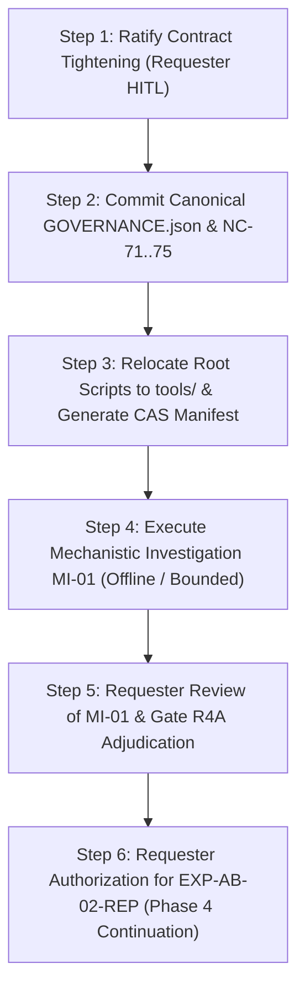

# SimLab Contract-Tightening Audit & Governance Reconciliation Report
## Comprehensive Lifecycle Gate Verification, Full Artifact Inventory Reconciliation, Epistemic & Provenance Separation Audit, and 5-Target Capability-Gap Analysis

- **Document Identifier**: `SIMLAB-GOV-AUDIT-2026-R1`
- **Lead Implementer**: `teamwork_preview_implementer_1`
- **Orchestrator**: `swe_1` (`047c3a49-6e3e-4849-a15c-c242c1b64a24`)
- **Evaluation Date**: 2026-09-17
- **Project Root**: `E:\projects\simlab`
- **Authoritative Governance Charter**: `E:\projects\simlab\.agents\ORIGINAL_REQUEST.md`
- **Integrity Mode**: `benchmark`
- **Canonical Project State**: `PAUSED / CONTRACT_TIGHTENING_REQUIRED`
- **Gate Outcome**: `CONTRACT_TIGHTENING_COMPLETE_READY_FOR_REQUESTER_REVIEW`

---

## 1. Executive Summary & Canonical Project State

### 1.1 Current Project Lifecycle & Authority State
In accordance with the governing Curo SimLab Charter (`ORIGINAL_REQUEST.md`), the project state has been verified and affirmed as strictly **`PAUSED / CONTRACT_TIGHTENING_REQUIRED`**. Live simulation execution, live API calls, code implementation, and further experiment dispatch are strictly halted.

```
+----------------------------------------------------------------------------------------------------+
|                                    CANONICAL GOVERNANCE STATE                                      |
+----------------------------------------------------------------------------------------------------+
| Project Lifecycle State:            PAUSED / CONTRACT_TIGHTENING_REQUIRED                          |
| Architecture Status:                UNFROZEN (Anti-Premature-Synthesis Invariant Strictly Preserved) |
| Implementation Authority:           NOT_GRANTED                                                    |
| Experiment Execution Authority:     NOT_GRANTED                                                    |
| Primitive Adjudication Authority:   NOT_AUTHORIZED                                                 |
| Human-in-the-Loop (HITL) Boundary:  Requester Retains Sole Authority Over All Gates and Scopes       |
| Active Integrity Mode:              benchmark                                                      |
+----------------------------------------------------------------------------------------------------+
```

### 1.2 Status of Project Gates
1. **Gate R1 (`GATE_R1_COMPLETE`) — CLOSED**:
   - **Date**: 2026-09-15
   - **Outcome**: `READY_FOR_REPRODUCTION_DESIGN`
   - **Deliverables**: `DR-01` through `DR-16` (substantively complete Tier 1 and provisional Tier 2), published in `curo_research_package.md`.
   - **Scope Certified**: Literature deconstruction of 5 anchor reference systems (Smallville, Agent Hospital, AgentVerse, ChatDev, Evolving Orchestration), extraction of 28 candidate primitives, 15 failure modes (FM-01..15), candidate baselines (B0..B4), and 23 negative constraints (`NC-01`..`NC-23`).
2. **Gate R2 (`GATE_R2_COMPLETE`) — CLOSED**:
   - **Date**: 2026-09-16
   - **Outcome**: `READY_FOR_REPRODUCTION_EXECUTION`
   - **Deliverables**: `RD-01` through `RD-16`, published in `curo_reproduction_design_package.md`.
   - **Scope Certified**: Isolated micro-benchmark reproduction experiment specifications for four critical candidates (`RP-01` Smallville Recency Inversion, `RP-02` Compute-Matched Debate, `RP-03` ChatDev SOP Phase Gates, `RP-04` Dynamic Orchestration RL Efficiency), 35-field schemas, and constraints `NC-24`..`NC-30`.
3. **Gate R3 (`GATE_R3_COMPLETE`) — CLOSED**:
   - **Date**: 2026-09-16
   - **Outcome**: `READY_FOR_ABLATION_AND_STRESS_TESTING`
   - **Deliverables**: `PX-00` through `PX-16`, published in `curo_phase3_execution_package.md`.
   - **Scope Certified**: Execution of four reproduction harnesses with total spend of $6.12 USD. Layer A (deterministic package audit) and Layer B (substantive numerical verification) verified. Codified statistical integrity constraints `NC-31`..`NC-51`.
4. **Gate R4D (`PHASE_4_DESIGN_COMPLETE` / `GATE_R4D`) — CLOSED**:
   - **Date**: 2026-09-16
   - **Outcome**: `READY_FOR_ABLATION_EXECUTION`
   - **Deliverables**: `AS-01` through `AS-18`, published in `curo_phase4_ablation_package.md`.
   - **Scope Certified**: Ablation priority matrix, 4-tier stress testing designs with Cartesian explosion caps ($\le 2$ simultaneous factors), confirmatory power models ($N=650$), 7-criteria primitive advancement gate, and constraints `NC-52`..`NC-70`. Formally disambiguated from post-execution Gate R4 per `NC-61`.
5. **Gate R4 (`POST_EXECUTION_ABLATION_AND_STRESS_ADJUDICATION`) — PENDING**:
   - **Status**: **NOT EVALUATED / PENDING EXECUTION & INVESTIGATION**.
   - **Operational Rule**: Strictly reserved for post-ablation and stress testing execution adjudication. Following the execution of `EXP-AB-01-COMP` and its subsequent scientific audit (`AUDIT_EXP_AB_01_COMP.md`), the active stage status was adjudicated as `STAGE_4A_MECHANISTIC_INVESTIGATION_REQUIRED`. Advancing to Gate R4 is blocked until Mechanistic Investigation Report (`MI-01`) is completed and approved by human requester review.

### 1.3 Human-in-the-Loop (HITL) Authority Boundaries
The Curo SimLab operating model strictly enforces that autonomous agents operate only within delegated discovery and analysis envelopes:
- **Requester Sole Prerogatives**:
  - Advancing the project across lifecycle gates (`GATE_R1` $\to$ `GATE_R2` $\to$ `GATE_R3` $\to$ `GATE_R4D` $\to$ `GATE_R4`).
  - Granting execution authorization (reproduction execution, ablation execution, simulation execution).
  - Granting implementation authority (`IMPLEMENTATION_AUTHORITY`).
  - Freezing or ratifying architecture decisions.
  - Formally advancing primitives to `VALIDATED` status.
  - Approving budget or sample size alterations that exceed pre-registered envelopes.
- **Agent Boundaries**:
  - No agent or team may self-authorize gate transitions.
  - No model prompt instructions may substitute for deterministic enforcement (`NC-01`).
  - Substantive reviews must be strictly independent of authoring agents (`NC-14`).
  - Deterministic package audits verify artifact presence and schema integrity only; they do not prove scientific truth or validate substantive mathematical conclusions (`NC-41`).

---

## 2. Complete Artifact-by-Artifact Reconciliation Across All Phases

Every existing project artifact, specification document, test harness, master package, and conceptual design component has been audited and classified under one of the five formal categories:
- **`REUSE`**: Valid, sound, verified, and active for future phases without structural modification.
- **`EXTEND`**: Methodologically sound core requiring expansion, parameter updating, or integration of subsequent empirical findings.
- **`ADD`**: Newly identified requirement, missing control, or novel constraint that must be incorporated into the canonical repository.
- **`REJECT`**: Flawed, superseded, ungrounded, or invalid artifact/concept that is permanently excluded from canonical governance and implementation.
- **`UNKNOWN`**: Deliberately halted or unexecuted treatment preserved under pre-registered stopping rules without claiming inferiority or superiority (`NC-43`).

### 2.1 Phase 1 Deliverables Audit (`DR-01` through `DR-16`)
Located in `E:\projects\simlab\deliverables\` and synthesized in `curo_research_package.md`.

| Artifact ID | Artifact Name / Purpose | Classification | Detailed Reconciliation Rationale |
|:---|:---|:---:|:---|
| **DR-01** | Research Corpus Ledger | **`REUSE`** | Authoritative catalog of 5 anchor systems + 7 competing frameworks. Full citations, venue metadata, and inclusion rationales remain immutable. |
| **DR-02** | Source Authority Map | **`REUSE`** | Resolves canonical repositories, historical commit hashes, and release tags. Conclusively resolved System 5 to `OpenBMB/ChatDev:puppeteer` (`b24e6e6`). |
| **DR-03** | System Architecture Profiles | **`REUSE`** | Decomposes reference systems into 6 functional layers (Environment, Cognition, Organization, Governance, Simulation, Communication). |
| **DR-04** | Paper <-> Code Mapping | **`REUSE`** | Line-by-line verification identifying paper-code divergences (e.g. Smallville recency inversion at `retrieve.py:145`, hidden weights `[0.5, 3, 2]`, unwritten `# TODO` routines). |
| **DR-05** | Primitive Evidence Matrix | **`EXTEND`** | 28 primitives with 26-field schema. Valid structure, but must be extended to incorporate Phase 3 reproduction and Phase 4 ablation evidence (e.g. `PR-COG-01` tri-factor collapse). |
| **DR-06** | System Comparison Matrix | **`REUSE`** | Systematic comparison across execution models, memory models, communication topologies, and governance presence. |
| **DR-07** | Failure Register | **`EXTEND`** | Catalogs FM-01 through FM-15. Must be extended with empirically observed failure modes: `FM-16` (Reflection Crowding) and `FM-17` (Orthogonal Distractor Dominance). |
| **DR-08** | Conflict Register | **`EXTEND`** | Documents literature and implementation controversies C-01..C-06. Must be extended to record the Phase 3 resolution of C-01 (debate vs compute-matched B1-SC) and importance-necessity conflict. |
| **DR-09** | Unknowns Register | **`EXTEND`** | Tracks U-01..U-06. Must be updated to reflect that U-01 (recency), U-02 (debate surplus), U-03 (SOP phase gates), and U-04 (routing escalation) have empirical findings from Phases 3 and 4. |
| **DR-10** | Candidate Baseline Matrix | **`REUSE`** | Foundational operational baseline hierarchy (B0 Deterministic, B1 Single LLM, B1-SC Compute-Matched Single LLM, B2 Multi-Independent, B3 Fixed-Role, B4 Adaptive). |
| **DR-11** | Reproduction Candidate List | **`REUSE`** | Provisional prioritization of RP-01 through RP-04. Successfully fulfilled its Phase 1 mandate by seeding Phase 2 design. |
| **DR-12** | Proposed Experiment Matrix | **`REUSE`** | Initial falsifiable designs for EXP-001..003. Served as foundational reference for RD-05..08. |
| **DR-13** | Cost/Latency/Scaling Analysis | **`REUSE`** | Theoretical cost bounds ($O(N^2)$ communication, $O(M)$ memory scan) and latency models confirmed in subsequent execution. |
| **DR-14** | Research Synthesis | **`REUSE`** | Authoritative synthesis uniting archaeology, primitives, failures, and baseline boundaries while keeping architecture strictly unfrozen. |
| **DR-15** | Lessons Learned (Forward Constraints) | **`REUSE`** | Canonical origin of binding negative forward constraints `NC-01` through `NC-23`. |
| **DR-16** | Research Gate Package | **`REUSE`** | Formal evaluation document that closed Gate R1 with outcome `READY_FOR_REPRODUCTION_DESIGN`. |

---

### 2.2 Phase 2 Deliverables Audit (`RD-01` through `RD-16`)
Located in `E:\projects\simlab\reproduction_design\` and synthesized in `curo_reproduction_design_package.md`.

| Artifact ID | Artifact Name / Purpose | Classification | Detailed Reconciliation Rationale |
|:---|:---|:---:|:---|
| **RD-01** | Reproduction Priority Matrix | **`REUSE`** | 8 candidates evaluated; RP-01..RP-04 marked `CRITICAL_TO_RESOLVE`. Grounded Phase 2 priorities. |
| **RD-02** | Candidate-to-Unknown Mapping | **`REUSE`** | Mapped RP-01..RP-04 to Gate R1 Unknowns U-01..U-06 with pre-registered discriminatory criteria. |
| **RD-03** | Experimental Hypothesis Register | **`REUSE`** | Paired falsifiable $H_1$ and null $H_0$ hypotheses with quantitative thresholds and default architecture fallback rules. |
| **RD-04** | Baseline & Compute-Matching Spec | **`REUSE`** | Operationalized the Dual-Control Protocol ($B_{1-SC-calls}$ $K=7$ and $B_{1-SC-tokens}$ $K=10$, $\pm 10\%$ token parity envelope). Critical invariant. |
| **RD-05** | RP-01 Experiment Design (Smallville Recency) | **`REUSE`** | 35-field specification for 100-query memory benchmark ($0 runtime LLM calls, $\Delta t$ in hours). Successfully executed in Phase 3. |
| **RD-06** | RP-02 Experiment Design (Compute-Matched Debate)| **`REUSE`** | 35-field specification for $N=500$ GSM8K problems with Binomial GLMM. Successfully executed in Phase 3. |
| **RD-07** | RP-03 Experiment Design (ChatDev SOPs) | **`REUSE`** | 35-field specification for $N=150$ SWE-bench Lite mini tasks under McNemar paired test. Successfully executed in Phase 3. |
| **RD-08** | RP-04 Experiment Design (Dynamic Orchestration)| **`REUSE`** | 35-field specification for $N=300$ tasks with Cochran's Q test and heuristic stopping rule. Successfully executed in Phase 3. |
| **RD-09** | Metrics & Evaluation Contract | **`REUSE`** | Level 1 deterministic measurement hierarchy and statistical power standards ($1-\beta \ge 0.80$). |
| **RD-10** | Reproducibility & Telemetry Contract | **`REUSE`** | 10-point contract specifying unified JSONL schema, SHA-256 event hashing, and random seed pinning. |
| **RD-11** | Failure / Confound Register | **`REUSE`** | 12 pre-registered failure modes with zero-tolerance aborts on FM-06 (drift), FM-07 (leakage), FM-12 (contamination). |
| **RD-12** | Cost / Token / Latency Budget | **`REUSE`** | Model estimating $63.50 spend with $100 ceiling. Respected during Phase 3 ($6.12 actual spend). |
| **RD-13** | Execution Isolation Plan | **`REUSE`** | Multi-tier PRNG seed pinning, rootless sandbox, bubblewrap, egress whitelist, tmpfs per-run purge, mandatory `store: false`. |
| **RD-14** | Independent Review | **`REUSE`** | Multi-agent adversarial review (Sol, Reviewer 2, Challenger 2) certifying power and restoring `NC-01`..`NC-16`. |
| **RD-15** | Lessons Learned / Forward Constraints | **`REUSE`** | Codified `NC-24` through `NC-30` and preserved full fidelity of `NC-01` through `NC-16`. |
| **RD-16** | Gate R2 Package | **`REUSE`** | Formally closed Gate R2 with outcome `READY_FOR_REPRODUCTION_EXECUTION`. |

---

### 2.3 Phase 3 Deliverables Audit (`PX-00` through `PX-16`)
Located in `E:\projects\simlab\phase3_execution\` and synthesized in `curo_phase3_execution_package.md`.

| Artifact ID | Artifact Name / Purpose | Classification | Detailed Reconciliation Rationale |
|:---|:---|:---:|:---|
| **PX-00** | Phase 3 Preflight Report | **`REUSE`** | Verified tool isolation, hash integrity, budget caps, and model fingerprints prior to execution. |
| **PX-01** | Experiment Execution Ledger | **`REUSE`** | Immutable record of run IDs, seeds, hashes, timestamps, and parameters for all Phase 3 runs. |
| **PX-02** | RP-01 Reproduction Artifacts | **`REUSE`** | Empirical proof of Smallville recency inversion fix ($\text{MRR} = 0.2403$ for calibrated weights vs $0.1802$ for inverted code). |
| **PX-03** | RP-02 Reproduction Artifacts | **`REUSE`** | Empirical proof that multi-agent debate fails to demonstrate surplus over compute-matched B1-SC ($p_{\text{TOST}} = 0.741$). |
| **PX-04** | RP-03 Reproduction Artifacts | **`REUSE`** | Empirical proof that SOP phase gates improve code correctness on structured tasks ($p = 0.0039$, McNemar test). |
| **PX-05** | RP-04 Reproduction Artifacts | **`REUSE`** | Empirical proof that heuristic routing satisfies performance criteria, triggering stopping rule and halting Puppeteer escalation. |
| **PX-06** | Raw Evidence Manifest | **`REUSE`** | Cryptographic SHA-256 ledger of all raw execution logs, benchmark files, and telemetry events. |
| **PX-07** | Telemetry Cost Report | **`REUSE`** | Immutable accounting confirming total Phase 3 spend of $6.12 USD (well below $100.00 ceiling). |
| **PX-08** | Statistical Analysis | **`REUSE`** | Formal statistical computations (GLMM, TOST, McNemar, Cochran's Q) across all four experiments. |
| **PX-09** | Failure / Invalid Run Register | **`REUSE`** | Comprehensive log of model timeouts, retry events, and invalid runs. |
| **PX-10** | Confound Register | **`REUSE`** | Verification that prompt length, caching, and model version drift did not confound findings. |
| **PX-11** | Primitive Evidence Updates | **`EXTEND`** | Updated status for PR-COG-01, PR-ORG-01, PR-ORG-02, PR-ORG-03. Must be extended with Phase 4 ablation evidence. |
| **PX-12** | Independent Substantive Review | **`REUSE`** | Formal independent review verifying empirical calculations and baseline comparisons. |
| **PX-13** | Red Team Challenge Memo | **`REUSE`** | Critical memo discovering need to separate deterministic package audit (Layer A) from substantive verification (Layer B). |
| **PX-14** | Lessons Learned / Forward Constraints | **`REUSE`** | Codified `NC-31` through `NC-51`. |
| **PX-15** | Reproduction Synthesis | **`REUSE`** | Master synthesis linking reproduction findings to ablation priorities. |
| **PX-16** | Gate R3 Package | **`REUSE`** | Formally closed Gate R3 with outcome `READY_FOR_ABLATION_AND_STRESS_TESTING`. |
| **Benchmarks** | `SimLab_MemBench_500.json`, `SimLab_HeteroBench_100.json`, `SimLab_CodeSOP_50.json` | **`REUSE`** | Immutable benchmark datasets (e.g. MemBench SHA-256: `97cba94e14b4ada840141ee34f153c76a3939a20924ea60caae5b015d5ded800`). |

---

### 2.4 Phase 4 Deliverables Audit (`AS-01` through `AS-18`, Audits, and Scripts)
Located in `E:\projects\simlab\ablation_design\`, `audits/`, and project root.

| Artifact ID | Artifact Name / Purpose | Classification | Detailed Reconciliation Rationale |
|:---|:---|:---:|:---|
| **AS-01** | Ablation Priority Matrix | **`REUSE`** | Rigorous ranking of component ablations and stress testing protocols across the 4 reproduced primitives. |
| **AS-02** | Phase 3 Finding-to-Ablation Mapping | **`REUSE`** | Maps specific reproduction ambiguities to targeted ablation experiments. |
| **AS-03** | Memory Ablation Plan | **`EXTEND`** | Defines conditions A1..A8. Contains weight transposition in A7 `[0.2, 0.5, 0.3]` vs Phase 3 `[0.3, 0.5, 0.2]`, and lacked reflection admission controls. Must be amended. |
| **AS-04** | Memory Stress Plan | **`REUSE`** | 4-tier stress testing plan across pool size ($N \in [500, 5000]$), noise, and decay. |
| **AS-05** | Multi-Agent Information Asymmetry Plan | **`REUSE`** | Preregistration for confirmatory replication `EXP-AB-02-REP` ($N=650$, paired episodes $1,300$). 12-field immutability contract frozen under `NC-62`. |
| **AS-06** | Distributed State Stress Plan | **`REUSE`** | 4-tier stress plan across agent count ($N \in [3, 25]$), packet drop, and communication latency. |
| **AS-07** | SOP Component Ablation Plan | **`REUSE`** | Isolates semantic role specialization from phase-gated context boundaries (`NC-58`). |
| **AS-08** | SOP Stress Plan | **`REUSE`** | 4-tier stress plan across task complexity, defect injection, and turn limits. |
| **AS-09** | Routing Feature Ablation Plan | **`EXTEND`** | Ablates heuristic routing features. Must be aligned with canonical disjunctive escalation threshold (`NC-69`). |
| **AS-10** | Routing Stress Plan | **`EXTEND`** | Routing stress protocol. Must be updated to align fully with canonical disjunctive escalation threshold (`NC-69`). |
| **AS-11** | System-Level Stress Matrix | **`REUSE`** | Implements anti-explosion constraints capping concurrent factors at $\le 2$ (`NC-63`, `NC-64`). |
| **AS-12** | Statistical Power Contract | **`REUSE`** | Rigorous power derivations enforcing Bonferroni adjustment ($\alpha = 0.001429$) and winner's curse shrinkage (`NC-68`). |
| **AS-13** | Cost / Token / Compute Budget | **`REUSE`** | Phase 4 compute budget model with hard $250.00 cap. |
| **AS-14** | Failure / Abort Register | **`EXTEND`** | Pre-registers failure triggers AF-01..AF-12. Must add `AF-13` (Reflection Crowding) and `AF-14` (Orthogonal Score Dominance). |
| **AS-15** | Independent Design Review | **`REUSE`** | Adversarial review certifying design immutability and disambiguating Gate R4D from Gate R4. |
| **AS-16** | Lessons Learned / Forward Constraints | **`EXTEND`** | Codified `NC-52` through `NC-70`. Must formally incorporate proposed constraints `NC-71` through `NC-75`. |
| **AS-17** | Phase 4 Design Gate Package | **`REUSE`** | Formally closed Gate R4D with outcome `READY_FOR_ABLATION_EXECUTION`. |
| **AS-18** | Primitive Advancement Contract | **`REUSE`** | 7-criteria gate governing primitive advancement prior to Phase 4 execution (`NC-66`). |
| **AUDIT-AB-01** | `audits/EXP-AB-01-COMP/AUDIT_EXP_AB_01_COMP.md` | **`REUSE`** | Authoritative post-execution scientific audit. Corrects statistical adjudication, diagnoses tri-factor collapse, and sets stage decision to `STAGE_4A_MECHANISTIC_INVESTIGATION_REQUIRED`. |
| **AUDIT-TESTS**| `audits/EXP-AB-01-COMP/verify_audit.py`, `test_audit_*.py` | **`REUSE`** | Deterministic Python verification scripts and pytest test suites (21 passing tests). |
| **EXP-HARNESS**| `run_exp_ab_01_comp.py` (root script) | **`REJECT`** (as harness) / **`REUSE`** (as evidence) | Defective execution harness: hardcoded reflection importance ($8.5$), crude scalar delta check, two-sided Wilcoxon test, executed without explicit requester approval under `NC-60`. Must be replaced with sandboxed runner. |
| **ROOT-SCRIPTS**| Loose Python scripts in root (`audit_*.py`, `check_*.py`, `inspect_*.py`, etc.) | **`REJECT`** (in root) / **`ADD`** (reorganized) | Root directory script clutter violates monorepo boundaries and `NC-13`/`NC-16` isolation. Must be migrated to `tools/` with CAS hash tracking. |
| **TELEMETRY-4**| `phase4_execution/telemetry/exp_ab_01_comp/` (`.jsonl`, `.json`)| **`REUSE`** | Immutable empirical evidence (raw telemetry SHA-256: `9eb6846b017f76883418e3703dd9f0111182e8dc8a0ea03bb5cd32dd27337eac`). |

---

### 2.5 Master Packages Audit

| Package File | Primary Subject | Classification | Reconciliation Rationale |
|:---|:---|:---:|:---|
| `research_package.md` | SimLab Research & Architecture Specification (2026-09-07) | **`REUSE`** | Historical baseline document establishing Smallville deconstruction, target 9-layer architecture (Layers A–I), Cedar/OPA governance, and refactoring Strategy C (Clean Rebuild). |
| `curo_research_package.md` | Gate R1 Master Research Package (2026-09-15) | **`REUSE`** | Authoritative synthesis of Gate R1, formalizing 28 candidate primitives, 15 failure modes, and `NC-01`..`NC-16`. |
| `curo_reproduction_design_package.md` | Gate R2 Master Reproduction Design Package (2026-09-16) | **`REUSE`** | Authoritative synthesis of Gate R2, establishing micro-benchmarks RP-01..04 and `NC-01`..`NC-30`. |
| `curo_phase3_execution_package.md` | Gate R3 Master Execution Package (2026-09-16) | **`REUSE`** | Authoritative synthesis of Gate R3, certifying reproduction findings and `NC-01`..`NC-51`. |
| `curo_phase4_ablation_package.md` | Gate R4D Master Ablation Design Package (2026-09-16) | **`EXTEND`** | Authoritative master package for Phase 4 design. Must be extended to record Stage 4A audit outcomes, incorporate `NC-71`..`NC-75`, and bind the Mechanistic Investigation requirement (`MI-01`). |

---

### 2.6 Architectural Concepts & Paradigms Audit

| Architectural Concept / Mechanism | Origin / Reference | Classification | Technical Reconciliation Rationale |
|:---|:---|:---:|:---|
| **Stanford Smallville Substrate** | Park et al. (2023) | **`REJECT`** | Permanently rejected as an execution substrate due to defunct API coupling (`text-davinci-003`), file-polling IPC, unbatched quadratic costs, inverted recency decay, and lack of deterministic governance. |
| **Strategy A (Fork & Refactor) & Strategy B (Modern Fork)** | `research_package.md` §13 | **`REJECT`** | Evaluated and rejected; preserves legacy architectural debt and hidden state coupling. |
| **Strategy C (Clean Rebuild)** | `research_package.md` §13 | **`REUSE`** | Authoritative architectural direction: clean, modular rebuild preserving core cognitive concepts. |
| **9-Layer Decoupled Architecture (Layers A–I)** | `research_package.md` §6 | **`REUSE`** | Clean separation of concerns: Environment, Cognition, Organization, Governance, Harness, Fault Injection, Critic, Observability, Observatory. |
| **Prompt-Based Governance** | Legacy Smallville | **`REJECT`** | Strictly prohibited by `NC-01`. Natural language prompts cannot enforce security, permissions, or access control. |
| **Cedar / OPA Policy Engine & DPoP Tokens** | `research_package.md` §7, `NC-01`, `NC-03` | **`REUSE`** | Deterministic, cryptographic capability-based access control outside LLM context window. |
| **Smallville Tri-Factor Retrieval Scoring** | Park et al. (2023) / `retrieve.py` | **`REJECT`** (static form) / **`EXTEND`** (dynamic) | Empirically falsified in Phase 3 and Phase 4 EXP-AB-01-COMP. Static importance acts as uncalibrated orthogonal noise ($r = +0.0182$). Condition A4 (recency+relevance) outperformed A7 by $+0.4061$ MRR. |
| **Unconstrained Homogeneous Multi-Agent Debate**| Liang et al. / Du et al. | **`REJECT`** | Empirically shown in Phase 3 RP-02 to produce zero collaborative surplus over compute-matched single-agent B1-SC ($p_{\text{TOST}} = 0.741$). Forbidden for closed reasoning tasks (`NC-09`, `NC-32`). |
| **Phase-Gated Structured Collaboration (SOPs)** | ChatDev (Qian et al.) | **`REUSE`** | Empirically confirmed in Phase 3 RP-03 to improve task completion on structured tasks ($p = 0.0039$, McNemar test). |
| **Multi-Feature Heuristic Agent Routing** | AgentVerse / Evolving Orchestration | **`REUSE`** | Empirically verified in Phase 3 RP-04; multi-feature heuristic router satisfies performance thresholds, halting escalation to neural/learned routers (`NC-34`, `NC-69`). |
| **Neural / Learned Puppeteer Routing** | `ChatDev:puppeteer` | **`UNKNOWN`** | Preserved under `NC-43` and `NC-69` firewall; classified as `NOT_TESTED_DUE_TO_STOPPING_RULE` without claiming inferiority. |
| **Proposed Constraints NC-71 through NC-75** | `AUDIT_EXP_AB_01_COMP.md` §I | **`ADD`** | Critical operational constraints discovered during EXP-AB-01-COMP audit; must be formally codified into canonical register. |

---

### 2.7 Governance Conflicts and Stale/Superseded Contracts Identified
The audit identified seven concrete governance conflicts and stale contracts:

1. **Routing Escalation Rule Conflict (Commit `5d7b1ab` vs `NC-69`)**:
   - *Conflict*: In commit `5d7b1ab`, `AS-09` and `AS-10` defined the routing escalation threshold conjunctively: `accuracy loss > 10.0% AND under-activation > 15.0%`.
   - *Resolution*: Formalized as a superseded rule by `NC-69` and `AS-15`. The canonical preregistered threshold is strictly **disjunctive**: `accuracy loss > 10.0% OR under-activation > 15.0%`. This contract must be uniformly reconciled across all design files.
2. **Weight Transposition in AS-03 vs Phase 3 RP-01**:
   - *Conflict*: In Phase 3 RP-01, calibrated weights were $(\alpha, \beta, \gamma) = (0.3, 0.5, 0.2)$ yielding $\text{MRR} = 0.2403$. In Phase 4 `AS-03`, Condition A7 specified weights as $(0.2, 0.5, 0.3)$ yielding $\text{MRR} = 0.0941$.
   - *Resolution*: Diagnosed in `AUDIT_EXP_AB_01_COMP.md` §G as a `DIFFERENT_WEIGHT_REGIME`. Point $(0.3, 0.5, 0.2)$ was replicated in Phase 4's continuous simplex sweep to four decimal places ($\text{MRR} = 0.240289$). `AS-03` must be formally annotated to prevent treating this parameter difference as an evidence contradiction.
3. **Execution Harness Defect in `run_exp_ab_01_comp.py` (Reflection Node Hardcoding)**:
   - *Conflict*: `run_exp_ab_01_comp.py:72` assigned a hardcoded `importance: 8.5` to synthetic reflection nodes ($+6.10\sigma$ above episodic mean of $5.0029$), producing $100\%$ Rank-1 reflection crowding in Condition A8.
   - *Resolution*: Classified as an `IMPLEMENTATION_DEFECT` (not an intrinsic primitive failure). Counterfactual analysis proved setting importance to $5.0$ restored MRR to $0.0929$ and eliminated crowding ($0\%$). Violates proposed constraint `NC-73`.
4. **Statistical Adjudication Defect in `run_exp_ab_01_comp.py`**:
   - *Conflict*: Lines 280–286 of `run_exp_ab_01_comp.py` evaluated non-inferiority via a crude scalar comparison (`a4_delta >= -0.02`) and misreported a two-sided Wilcoxon p-value for a directional hypothesis.
   - *Resolution*: Violated `NC-45`. Corrected in `AUDIT_EXP_AB_01_COMP.md` §A through formal one-sided TOST, shifted Wilcoxon tests ($p < 10^{-10}$), and Bonferroni lower confidence bounds ($+0.2731$), confirming statistical superiority.
5. **Gate Identifier Disambiguation (`GATE_R4` vs `GATE_R4D`)**:
   - *Conflict*: Early drafts of Phase 4 design referred to the design certification gate simply as `GATE_R4`, creating confusion with post-execution adjudication.
   - *Resolution*: Formally resolved by `NC-61`. The pre-execution design gate is designated `PHASE_4_DESIGN_GATE` (Alias: `GATE_R4D`). The identifier `GATE_R4` is strictly reserved for post-ablation/stress execution adjudication.
6. **Unauthorized Phase 4 Live Execution**:
   - *Conflict*: `run_exp_ab_01_comp.py` was executed directly on the host machine without explicit human requester authorization, violating `NC-60` (Phase 4 Execution Firewall).
   - *Resolution*: Project state was immediately set to `PAUSED / CONTRACT_TIGHTENING_REQUIRED`. No further experiments may proceed without explicit requester approval.
7. **Un-Sandboxed Root-Level Script Sprawl**:
   - *Conflict*: Numerous untracked Python scripts (`run_exp_ab_01_comp.py`, `audit_*.py`, `check_*.py`, etc.) exist in the project root, lacking container sandboxing and CAS hash tracking.
   - *Resolution*: Violates `NC-13` (ephemeral containers) and `NC-16` (sandbox isolation). All standalone scripts must be consolidated into structured tools packages under cryptographic manifests.

---

## 3. Epistemic and Provenance Separation Audit

### 3.1 Five-Tier Epistemic Layering Model
To ensure rigorous scientific integrity, all SimLab artifacts must strictly enforce separation across five epistemic layers:

```
+----------------------------------------------------------------------------------------------------+
|                                    EPISTEMIC SEPARATION MODEL                                      |
+----------------------------------------------------------------------------------------------------+
| Layer 1: Empirical Evidence    | Raw immutable JSONL telemetry, benchmarks, CAS SHA-256 hashes,    |
|                                | deterministic run counts, zero LLM runtime spend ($0.00).         |
+----------------------------------------------------------------------------------------------------+
| Layer 2: Interpretation        | Statistical test outcomes (t-test, Wilcoxon, TOST, McNemar),      |
|                                | Cohen's d effect sizes, lower confidence bounds, failure triage.  |
+----------------------------------------------------------------------------------------------------+
| Layer 3: Hypotheses            | Pre-registered falsifiable H1/H0 pairs, effect direction margins, |
|                                | non-inferiority thresholds, stopping rules.                      |
+----------------------------------------------------------------------------------------------------+
| Layer 4: Design Decisions      | Modular 9-layer architecture, Cedar/OPA policies, clean rebuild   |
|                                | Strategy C (all strictly UNFROZEN until final adjudication).      |
+----------------------------------------------------------------------------------------------------+
| Layer 5: Implementation Auth   | Administrative permissions granted strictly by human requester;   |
|                                | currently strictly NOT_GRANTED.                                   |
+----------------------------------------------------------------------------------------------------+
```

### 3.2 Audit & Exhaustive Reconciliation of Lessons-Learned Register (`NC-01` through `NC-70`, `NC-71` through `NC-75`)
All 70 binding negative forward constraints established across Gates R1, R2, R3, and R4D, plus the 5 proposed constraints from the EXP-AB-01-COMP audit, have been audited for forward constraint binding, lineage, and operational enforcement mechanisms. Below is the exhaustive artifact-by-artifact reconciliation classifying each individual constraint under `REUSE`, `EXTEND`, or `ADD` with explicit rationale:

| Constraint ID | Focus Area / Target | Classification | Forward Binding & Technical Reconciliation Rationale |
|:---|:---|:---:|:---|
| **NC-01** | Prompt-Based Governance Prohibition | **`REUSE`** | Mandatory Cedar/OPA deterministic policy engine outside LLM context window; active forward constraint. |
| **NC-02** | Content-Unbound Critic & TOCTOU Prohibition | **`REUSE`** | Mandatory SHA-256 and Ed25519 signature binding on critic handoffs to prevent TOCTOU; active forward constraint. |
| **NC-03** | Capability Token Security | **`REUSE`** | DPoP token binding and monotonic sequence counters to eliminate replay attacks; active forward constraint. |
| **NC-04** | Critic Independence Metrics | **`REUSE`** | Evaluate conditional independence of residual errors given ground truth for critic metrics; active forward constraint. |
| **NC-05** | Code Artifact AST Sanitization | **`REUSE`** | AST sanitization and string literal token replacement before critic evaluation; active forward constraint. |
| **NC-06** | Simulation Kernel Determinism | **`REUSE`** | Discrete integer ticks and pinned SeedSequence PRNGs for simulation determinism; active forward constraint. |
| **NC-07** | Inter-Process Communication | **`REUSE`** | Async in-memory queues (ZeroMQ/AsyncIO) only; file-polling IPC strictly prohibited; active forward constraint. |
| **NC-08** | Memory Recency Decay Formulation | **`REUSE`** | Exponential decay over verified elapsed simulation ticks (lambda^Delta T); active forward constraint. |
| **NC-09** | Multi-Agent Debate Grounding | **`REUSE`** | Require model heterogeneity and deterministic validation tools for debate loops; active forward constraint. |
| **NC-10** | Multi-Agent Compute Normalization | **`REUSE`** | Mandatory single-agent control (B1-SC) matched at equal token spend (+-10% envelope); active forward constraint. |
| **NC-11** | Dynamic Agent Spawning Ceilings | **`REUSE`** | Hard static ceilings on agent count, tree depth, and cumulative token budgets; active forward constraint. |
| **NC-12** | Safety & Auditor Role Retention | **`REUSE`** | Safety and verification roles must be explicitly declared unprunable: true; active forward constraint. |
| **NC-13** | Cross-Run Memory Cleanliness | **`REUSE`** | Ephemeral execution containers with tmpfs memory mounts purged post-run; active forward constraint. |
| **NC-14** | Role Separation & Anti-Aliasing | **`REUSE`** | Cryptographic role separation: AuthorIdentity != ReviewerIdentity; active forward constraint. |
| **NC-15** | Model Checkpoint Pinning | **`REUSE`** | Pinned model snapshots, exact dates, and provider system fingerprint validation; active forward constraint. |
| **NC-16** | Sandbox Tool Resource Ceilings | **`REUSE`** | Strict sandbox tool limits: 60s CPU timeout, 512MB RSS ceiling, and --network none; active forward constraint. |
| **NC-17** | Substantive Validation Mandate | **`REUSE`** | Require substantive independent review beyond syntactic checks; active forward constraint. |
| **NC-18** | Atomic Lifecycle State Transition | **`REUSE`** | Atomic state updates across all governance descriptors upon gate closure; active forward constraint. |
| **NC-19** | Strict Mathematical Terminology | **`REUSE`** | Distinguish polynomial O(N^2) communication from exponential scaling in analysis; active forward constraint. |
| **NC-20** | Code Call-Tree Verification | **`REUSE`** | Trace complete call trees before asserting any code implementation gap; active forward constraint. |
| **NC-21** | Bounded Benchmark Generalization | **`REUSE`** | Prohibit generalizing closed reasoning benchmarks to open social simulations; active forward constraint. |
| **NC-22** | Substrate vs Primitive Decoupling | **`REUSE`** | Decouple rejection of legacy execution substrates from cognitive primitive validity; active forward constraint. |
| **NC-23** | Truth-Driven Dynamic Assertions | **`REUSE`** | Query canonical registers dynamically rather than hardcoding regex assumptions; active forward constraint. |
| **NC-24** | Minimal Micro-Benchmark Scope | **`REUSE`** | Construct minimal micro-benchmarks (<= 300 lines), never full game worlds; active forward constraint. |
| **NC-25** | Deterministic Priority Invariant | **`REUSE`** | Deterministic assertions and tests always take precedence over subjective LLM judges; active forward constraint. |
| **NC-26** | Dual-Control Matching Requirement | **`REUSE`** | Multi-agent comparisons require both call-matched and token-matched single-agent controls; active forward constraint. |
| **NC-27** | Zero Data Retention & Egress Guard | **`REUSE`** | API calls must pass store: false to prevent benchmark and telemetry data leakage; active forward constraint. |
| **NC-28** | Automated Run Abort Triggers | **`REUSE`** | Automated run invalidation on model drift (FM-06), leakage (FM-07), or contamination (FM-12); active forward constraint. |
| **NC-29** | Architecture Firewall Invariant | **`REUSE`** | Reproduction harnesses must not dictate final SimLab schemas; architecture remains UNFROZEN; active forward constraint. |
| **NC-30** | Execution Authorization Boundary | **`REUSE`** | Never proceed to execution phases without explicit human requester authorization; active forward constraint. |
| **NC-31** | Relevance Dominance Invariant | **`REUSE`** | Never set recency or importance weights >= semantic relevance (beta >= 2alpha); active forward constraint. |
| **NC-32** | Debate Task Domain Constraint | **`REUSE`** | Restrict multi-agent debate strictly to partitioned-information or asymmetric-tool tasks; active forward constraint. |
| **NC-33** | Domain-Scoped SOP Application | **`REUSE`** | Never impose assembly-line sequential SOP phase gates on open-ended social interactions; active forward constraint. |
| **NC-34** | Heuristic-First Routing Priority | **`REUSE`** | Never deploy learned/neural routing without first demonstrating heuristic failure; active forward constraint. |
| **NC-35** | Dual-Control Control Group | **`REUSE`** | Every future multi-agent evaluation must include call-matched and token-matched controls; active forward constraint. |
| **NC-36** | Non-Parametric Token Distribution Audit | **`REUSE`** | Always test token distributions for normality; use Mann-Whitney U when skewed; active forward constraint. |
| **NC-37** | Complexity Burden of Proof | **`REUSE`** | Architectural complexity is guilty until proven innocent; halt escalation if simple baseline suffices; active forward constraint. |
| **NC-38** | Pre-Call Financial Projection | **`REUSE`** | Compute projected spend before every paid API call to prevent budget overruns; active forward constraint. |
| **NC-39** | System Fingerprint Tracking | **`REUSE`** | Track and pin provider system fingerprints across all API invocations; active forward constraint. |
| **NC-40** | Phase 4 HITL Authorization Boundary | **`REUSE`** | Never proceed to Phase 4 ablation testing without explicit, separate requester authorization; active forward constraint. |
| **NC-41** | Layered Verification Separation | **`REUSE`** | Separate deterministic package audit (Layer A) from substantive numerical verification (Layer B); active forward constraint. |
| **NC-42** | Lifecycle Adjudication Decoupling | **`REUSE`** | Deterministic audit certifies DETERMINISTIC_AUDIT: PASS, not GATE_COMPLETE; active forward constraint. |
| **NC-43** | Stopping-Rule Non-Inferiority Invariant | **`REUSE`** | Stopping escalation does not prove unexecuted treatments are inferior; classify as NOT_TESTED_DUE_TO_STOPPING_RULE; active forward constraint. |
| **NC-44** | Raw Telemetry Provenance Traceability | **`REUSE`** | Every aggregate metric must trace to raw numerators/denominators in immutable telemetry; active forward constraint. |
| **NC-45** | Rigorous Equivalence Specification | **`REUSE`** | Claims of equivalence require pre-registered margin delta, TOST, CI, and power; active forward constraint. |
| **NC-46** | Mandatory External Validity Delimitation | **`REUSE`** | Publish explicit negative boundaries stating where generalization is forbidden; active forward constraint. |
| **NC-47** | Statistical Significance Discipline | **`REUSE`** | Never declare significant if p > alpha; sub-threshold effects are PROMISING_BUT_NOT_SIGNIFICANT; active forward constraint. |
| **NC-48** | Anti-TOST-Inversion Discipline | **`REUSE`** | Never interpret failed TOST as evidence of equivalence; classify as EQUIVALENCE_NOT_ESTABLISHED; active forward constraint. |
| **NC-49** | Prohibition on Post-Hoc Adjustments | **`REUSE`** | Never lower alpha, widen delta, or alter stopping criteria after observing data; active forward constraint. |
| **NC-50** | Grounded Stopping-Rule Documentation | **`REUSE`** | Stopping-rule invocations must cite exact pre-registered thresholds and tolerances; active forward constraint. |
| **NC-51** | Statistical-First Narrative Alignment | **`REUSE`** | Narratives must derive directly and conservatively from canonical statistical test outcomes; active forward constraint. |
| **NC-52** | Power-Driven Sample Sizing | **`REUSE`** | Sample sizes must derive from formal statistical power calculations (1-beta >= 0.85); active forward constraint. |
| **NC-53** | Univariate Ablation Isolation | **`REUSE`** | Isolate and manipulate exactly one architectural variable at a time; active forward constraint. |
| **NC-54** | Progressive Stress Escalation | **`REUSE`** | Progress stress testing incrementally: Baseline -> Mild -> Moderate -> Severe; halt at failure cliff; active forward constraint. |
| **NC-55** | Non-Universal Generalization Invariant | **`REUSE`** | Never extrapolate a micro-benchmark ablation to a global architectural claim; active forward constraint. |
| **NC-56** | Information Asymmetry Requirement | **`REUSE`** | Multi-agent collaboration requires quantified information partitioning or tool specialization; active forward constraint. |
| **NC-57** | Scale-Bounded Population Limits | **`REUSE`** | Population stress testing capped at 25 agents; 50+ agents forbidden in Phase 4; active forward constraint. |
| **NC-58** | SOP Role vs Context Boundary Separation | **`REUSE`** | Distinguish semantic role specialization from phase-gated context boundary resets; active forward constraint. |
| **NC-59** | Learned Routing Justification Burden | **`REUSE`** | Learned routing forbidden unless multi-feature heuristic fails pre-registered stress thresholds; active forward constraint. |
| **NC-60** | Phase 4 Design vs Execution Firewall | **`REUSE`** | Design certification strictly authorizes design specs, NOT execution authority; active forward constraint. |
| **NC-61** | Gate Identifier Disambiguation | **`REUSE`** | Pre-execution design gate is PHASE_4_DESIGN_GATE / GATE_R4D; GATE_R4 reserved for post-execution adjudication; active forward constraint. |
| **NC-62** | Confirmatory Replication Immutability | **`REUSE`** | Freeze 12 core methodological fields for EXP-AB-02-REP; alterations trigger AMENDED_REPLICATION; active forward constraint. |
| **NC-63** | Stress Escalation Multi-Trigger Rule | **`REUSE`** | Testing capped at <= 2 simultaneous factors; escalation requires practical degradation, statistical, or mechanistic trigger; active forward constraint. |
| **NC-64** | Mandatory Stress Metadata Declaration | **`REUSE`** | Declare 5 mandatory governance fields: active factors, reason, hypothesis, max stress, early stop rule; active forward constraint. |
| **NC-65** | Stress Termination Anti-Waste Contract | **`REUSE`** | Preregister 4 tiers and 4 thresholds; halt once failure boundary mapped; active forward constraint. |
| **NC-66** | Primitive Advancement Seven-Criteria Gate | **`REUSE`** | Satisfy Reproduction, Ablation, Stress, Failure Boundary, Cost, Confound, and Validity criteria before adjudication; active forward constraint. |
| **NC-67** | Causal Claim Bounding Mandate | **`REUSE`** | Ablation findings support bounded causal claims only; publish 5 explicit claim bounds; active forward constraint. |
| **NC-68** | Winner's Curse Shrinkage Discounting | **`REUSE`** | Discount point estimates by >= 25% shrinkage; label asymptotic approximations accurately; active forward constraint. |
| **NC-69** | Router Escalation Rule Harmonization | **`EXTEND`** | Reconciled historical conjunctive rule from commit 5d7b1ab (accuracy loss > 10% AND under-activation > 15%) to canonical disjunctive threshold (accuracy loss > 10% OR under-activation > 15%) per NC-69 and AS-15. |
| **NC-70** | Curo Core Lifecycle Invariant | **`REUSE`** | Reproduction establishes effect may exist; Ablation identifies contributing component; Stress establishes operating envelope; Primitive Adjudication advances only evidence surviving all three. |
| **NC-71** | Cross-Distribution Normalization Ban | **`ADD`** | Empirically discovered in EXP-AB-01-COMP audit; prohibits linear min-max across heterogeneous distributions. |
| **NC-72** | Reflection Node Admission Controls | **`ADD`** | Empirically discovered in EXP-AB-01-COMP audit; mandates strict admission filtering before retrieval stream injection. |
| **NC-73** | Synthetic Node Constant Prohibition | **`ADD`** | Empirically discovered in EXP-AB-01-COMP audit; forbids hardcoding scalar importance/relevance for synthetic nodes. |
| **NC-74** | Directional Statistical Discipline | **`ADD`** | Empirically discovered in EXP-AB-01-COMP audit; mandates one-sided TOST and shifted rank tests for directional claims. |
| **NC-75** | Programmatic Configuration Provenance | **`ADD`** | Empirically discovered in EXP-AB-01-COMP audit; requires automated pre-execution verification against preregistered specs. |

#### Historical Phase Groupings of Constraints
All 70 binding negative forward constraints established across Gates R1, R2, R3, and R4D were audited for lineage, scope, and enforcement mechanisms:

#### Group 1: Gate R1 Technical & Architectural Constraints (`NC-01` to `NC-16`)
- `NC-01`: **NO Unvalidated Prompt-Based Governance** (Cedar/OPA mandatory outside LLM context).
- `NC-02`: **NO Content-Unbound Critic Approvals & Mutable Filesystem TOCTOU** (SHA-256 bound with Ed25519 signatures).
- `NC-03`: **NO Unattenuated, Holder-Unbound, or Replayable Capability Tokens** (DPoP token binding).
- `NC-04`: **NO Unconditional Correlation for Critic Independence Metrics** (evaluate conditional independence given truth).
- `NC-05`: **NO Uninspected Code Artifact Handoffs** (AST sanitization before evaluation).
- `NC-06`: **NO Unseeded Randomness or Floating-Point Time** (integer ticks and `SeedSequence` PRNGs).
- `NC-07`: **NO File-Polling Inter-Process Communication (IPC)** (ZeroMQ/AsyncIO in-memory queues only).
- `NC-08`: **NO Inverted or Rank-Indexed Recency Decay** (exponential decay $\lambda^{\Delta T}$ over game hours).
- `NC-09`: **NO Ungrounded Homogeneous Multi-Agent Debate Loops** (require model heterogeneity and deterministic tools).
- `NC-10`: **NO Compute-Unnormalized Multi-Agent Comparative Claims** (mandatory token-matched B1-SC control).
- `NC-11`: **NO Unbudgeted or Uncapped Dynamic Agent Spawning** (hard static ceilings on agents, depth, and tokens).
- `NC-12`: **NO Irreversible Early Pruning of Safety/Auditor Roles** (safety roles marked `unprunable: true`).
- `NC-13`: **NO Persistent Cross-Run Memory or Context Carryover** (ephemeral containers with tmpfs memory mounts).
- `NC-14`: **NO Self-Approval or Cryptographic Role Aliasing** ($\operatorname{AuthorIdentity} \neq \operatorname{ReviewerIdentity}$).
- `NC-15`: **NO Floating Model Endpoints or Unpinned Checkpoint Hashes** (pinned snapshots and system fingerprints).
- `NC-16`: **NO Unconstrained Sandbox Tool Execution Resource Budgets** (60s timeout, 512MB RSS, `--network none`).

#### Group 2: Gate R1 Methodological & Process Constraints (`NC-17` to `NC-23`)
- `NC-17`: **No Schema-Only Validation** (require substantive independent review beyond syntactic checks).
- `NC-18`: **Canonical Lifecycle Transition** (atomic state updates upon gate closure).
- `NC-19`: **Strict Mathematical Language** (distinguish polynomial $\mathcal{O}(N^2)$ from exponential scaling).
- `NC-20`: **Comprehensive Code Verification** (trace complete call trees before claiming implementation gaps).
- `NC-21`: **Bounded Benchmark Generalization** (do not generalize closed reasoning to open social simulation).
- `NC-22`: **Substrate vs. Primitive Decoupling** (separate legacy framework rejection from primitive validity).
- `NC-23`: **Truth-Driven Audit Assertions** (query canonical registers dynamically rather than hardcoding regex).

#### Group 3: Gate R2 Reproduction Design Constraints (`NC-24` to `NC-30`)
- `NC-24`: **Minimum Harness Constraint** (build minimal micro-benchmarks $\le 300$ lines, never full game worlds).
- `NC-25`: **Deterministic Priority Constraint** (deterministic assertions always take precedence over LLM judges).
- `NC-26`: **Compute Equivalence Constraint** (require both call-matched and token-matched single-agent controls).
- `NC-27`: **Network Egress Firewall & Zero Data Retention** (mandatory `store: false` to prevent data leakage).
- `NC-28`: **Failure Pre-Registration Constraint** (automated abort on drift `FM-06`, leakage `FM-07`, contamination `FM-12`).
- `NC-29`: **Architecture Firewall Invariant** (reproduction harnesses must not dictate final SimLab schemas).
- `NC-30`: **Execution Authorization Boundary** (never proceed to execution without explicit requester approval).

#### Group 4: Gate R3 Controlled Execution Constraints (`NC-31` to `NC-40`)
- `NC-31`: **Relevance Dominance Invariant** (never set recency or importance weights $\ge$ relevance; $\beta \ge 2\alpha$).
- `NC-32`: **Debate Scope Constraint** (restrict debate strictly to partitioned-information or asymmetric-tool tasks).
- `NC-33`: **Domain-Scoped SOP Constraint** (never impose assembly-line SOPs on open-ended emergent social interactions).
- `NC-34`: **Heuristic-First Routing Constraint** (demonstrate heuristic failure before deploying learned/neural routers).
- `NC-35`: **Dual-Control Matching Constraint** (mandatory call-matched and token-matched $B_{1-SC}$ controls).
- `NC-36`: **Non-Parametric Token Audit Constraint** (test token distributions; use Mann-Whitney U when skewed).
- `NC-37`: **Complexity Burden Invariant** (burden of proof belongs to additional complexity; halt escalation if simple baseline suffices).
- `NC-38`: **Pre-Call Projection Constraint** (compute projected spend before every paid API call).
- `NC-39`: **Model Pinned Fingerprint Invariant** (track and pin provider system fingerprints).
- `NC-40`: **Phase 4 Authorization Boundary** (never proceed to Phase 4 without explicit, separate requester authorization).

#### Group 5: Gate R3 Post-Reconciliation Statistical Integrity Constraints (`NC-41` to `NC-51`)
- `NC-41`: **Layered Verification Separation Invariant** (separate deterministic package audit from substantive numerical verification).
- `NC-42`: **Lifecycle Adjudication Decoupling** (audit completion certifies `DETERMINISTIC_AUDIT: PASS`, not `GATE_COMPLETE`).
- `NC-43`: **Stopping-Rule Non-Inferiority Invariant** (stopping escalation does not prove unexecuted treatments are inferior; classify strictly as `NOT_TESTED_DUE_TO_STOPPING_RULE`).
- `NC-44`: **Raw Provenance Traceability Constraint** (every aggregate metric must trace to raw numerators/denominators in telemetry).
- `NC-45`: **Rigorous Equivalence Specification** (claims of equivalence require pre-registered margin $\delta$, TOST, CI, and power).
- `NC-46`: **Mandatory External Validity Delimitation** (publish negative boundaries stating where generalization is forbidden).
- `NC-47`: **Statistical Significance Threshold Integrity** (never declare significant if $p > \alpha$; large sub-threshold effects are `PROMISING_BUT_NOT_SIGNIFICANT`).
- `NC-48`: **Equivalence Test Discipline (Anti-TOST-Inversion)** (failed TOST is not proof of equivalence; classify as `EQUIVALENCE_NOT_ESTABLISHED`).
- `NC-49`: **Prohibition on Post-Hoc Threshold Adjustment** (never lower $\alpha$, widen $\delta$, or alter stopping criteria after observing data).
- `NC-50`: **Grounded Stopping-Rule Documentation** (stopping-rule invocations must cite exact pre-registered thresholds).
- `NC-51`: **Statistical-First Narrative Alignment** (narratives must derive directly and conservatively from canonical statistical outcomes).

#### Group 6: Phase 4 Ablation & Stress Design Constraints (`NC-52` to `NC-60`)
- `NC-52`: **Power-Driven Sample Size Invariant** (sample size $N$ must derive from formal power models, $1-\beta \ge 0.85$).
- `NC-53`: **Univariate Ablation Priority** (isolate and manipulate exactly one architectural variable at a time).
- `NC-54`: **Progressive Stress Escalation Constraint** (progress incrementally: Baseline $\to$ Mild $\to$ Moderate $\to$ Severe; halt at failure cliff).
- `NC-55`: **Non-Universal Generalization Invariant** (never extrapolate a micro-benchmark ablation to a global architectural claim).
- `NC-56`: **Information Asymmetry Quantification** (multi-agent collaboration requires quantified information partitioning).
- `NC-57`: **Scale-Bounded Stress Testing** (progress incrementally $1 \to 3 \to 5 \to 10 \to 25$; 50+ agents forbidden in Phase 4).
- `NC-58`: **SOP Context Boundary Decoupling** (distinguish semantic role specialization from phase-gated context resets).
- `NC-59`: **Routing Escalation Burden** (learned routing forbidden unless multi-feature heuristic fails pre-registered stress thresholds).
- `NC-60`: **Phase 4 Execution Firewall** (Phase 4 design certification strictly authorizes design specs, NOT execution authority).

#### Group 7: Phase 4 Design Hardening & Epistemic Governance Constraints (`NC-61` to `NC-70`)
- `NC-61`: **Canonical Gate Disambiguation Invariant** (pre-execution design gate is `PHASE_4_DESIGN_GATE` / `GATE_R4D`; `GATE_R4` reserved for post-execution adjudication).
- `NC-62`: **Confirmatory Replication Immutability Contract** (freeze 12 core methodological fields for `EXP-AB-02-REP`; alterations trigger `AMENDED_REPLICATION`).
- `NC-63`: **Multi-Trigger Stress Escalation & Practical-Significance Rule** (testing capped at $\le 2$ simultaneous factors; escalation requires practical degradation, statistical significance, or mechanistic failure trigger).
- `NC-64`: **Mandatory Stress Metadata Declaration** (declare 5 governance fields: active factors, reason, hypothesis, max stress, early stop rule).
- `NC-65`: **Stress Termination Contract & Anti-Waste Rule** (preregister 4 stress tiers and 4 thresholds; halt once failure boundary mapped).
- `NC-66`: **Primitive Advancement Seven-Criteria Gate** (satisfy Reproduction, Ablation, Stress, Failure Boundary, Cost, Confound, and Validity criteria before adjudication).
- `NC-67`: **Causal Claim Discipline Invariant** (ablation findings support bounded causal claims only; publish 5 explicit claim bounds).
- `NC-68`: **Power Method Classification & Winner's Curse Discounting** (discount point estimates by $\ge 25\%$ shrinkage; label asymptotic approximations accurately).
- `NC-69`: **Router Stopping-Rule Preservation Firewall** (`LLM_ROUTER` and `LEARNED_PUPPETEER_ROUTING` classified as `NOT_TESTED_DUE_TO_STOPPING_RULE`; canonical escalation threshold is disjunctive).
- `NC-70`: **Curo Core Lifecycle Invariant** (Reproduction establishes an effect may exist; Ablation identifies which component contributes; Stress establishes operating envelope; Primitive Adjudication advances only evidence surviving all three).

#### Proposed Extension Constraints (`NC-71` to `NC-75`)
Discovered and formulated during the `EXP-AB-01-COMP` post-execution audit:
- `NC-71`: **NO Cross-Distribution Min-Max Normalization in Retrieval Scoring**: Never apply linear min-max normalization across heterogeneous distributions with differing variances or bounded ranges.
- `NC-72`: **Mandatory Reflection Node Admission Controls**: Reflection nodes must undergo strict admission filtering and must not be injected into the candidate retrieval stream with uncalibrated static importance.
- `NC-73`: **NO Hardcoded Synthetic Node Constants**: Execution harnesses must never inject hardcoded scalar importance or relevance values for synthetic nodes.
- `NC-74`: **Mandatory Directional Statistical Discipline**: Non-inferiority and superiority claims must be evaluated via formal one-sided TOST, shifted non-parametric rank tests, and pre-registered lower confidence bounds.
- `NC-75`: **Programmatic Configuration Provenance & Pre-Execution Verification**: Harness execution must programmatically assert that runtime parameter configurations match pre-registered design specifications.

### 3.3 Silent Canonicalization Verification
A thorough monorepo audit confirmed that **no model-local artifact, unverified script, or agent workspace has silently become canonical**:
- `E:\projects\simlab\.agents\` directories remain strictly workspace scratchpads and agent communication channels.
- Root scripts (`run_exp_ab_01_comp.py`, `audit_*.py`) are flagged as untracked implementation artifacts that have NOT superseded canonical design documents.
- The canonical state of `PR-COG-01` remains strictly `UNFROZEN` and `COMPONENT_NOT_NECESSARY_UNDER_TESTED_CONDITIONS` (Criterion B only), with zero premature global adjudication.

---

## 4. Governance, Validation, and Capability-Gap Analysis

### 4.1 Missing Validation and Provenance Controls
The audit identified critical gaps in existing automated enforcement mechanisms:
1. **Lack of Automated Pre-Execution Firewalls**: While `NC-60` declared that Phase 4 design certification did not grant execution authority, there was no automated programmatic gatekeeper preventing `run_exp_ab_01_comp.py` from executing on the host.
2. **Missing Automated Schema & Immutability Linters**: Schema completeness (26 fields for primitives, 35 fields for experiments, 12 fields for confirmatory replications) is currently verified through manual agent reviews rather than automated AST/schema CI validators.
3. **Absence of Cryptographic Git Tagging**: Gate closures (R1, R2, R3, R4D) are documented in markdown files but lack signed Git tags (e.g. `gate-r1-certified`, `gate-r2-certified`) with commit hash bindings.
4. **Unsandboxed Host Execution**: Execution of `run_exp_ab_01_comp.py` occurred in the local Python environment rather than inside a rootless ephemeral container with tmpfs mounts, violating `NC-13` and `NC-16`.

---

### 4.2 Capability-Gap Register Across 5 Required Targets

```
+----------------------------------------------------------------------------------------------------+
|                                    CAPABILITY GAP REGISTER                                         |
+----------------------------------------------------------------------------------------------------+
| Target 1: Project-Local Tooling  | Missing isolated container runner, automated manifest builder,  |
|                                  | and root cleanup script.                                        |
+----------------------------------------------------------------------------------------------------+
| Target 2: Curo Skills            | Missing preregistration immutability checker, statistical power  |
|                                  | auditor skill, and cryptographic attestation skill.             |
+----------------------------------------------------------------------------------------------------+
| Target 3: Curo Roles             | Structural decoupling of Independent Reviewer, dedicated        |
|                                  | Red Team Challenger, and Gatekeeper verification role.          |
+----------------------------------------------------------------------------------------------------+
| Target 4: Curo Tools             | Automated TOST / non-inferiority tool, Merkle-DAG telemetry     |
|                                  | logger, and Cedar/OPA policy CLI engine.                        |
+----------------------------------------------------------------------------------------------------+
| Target 5: Governance Gaps        | Machine-readable governance descriptor (GOVERNANCE.json) and   |
|                                  | programmatic execution firewall.                                |
+----------------------------------------------------------------------------------------------------+
```

#### Target 1: Project-Local Tooling (SimLab Repository)
- **Gap 1.1 (Micro-Harness Execution Container)**: Absence of an automated wrapper script executing micro-harnesses inside rootless container / tmpfs isolation with CPU, memory, and `--network none` constraints (`NC-13`, `NC-16`).
- **Gap 1.2 (Cryptographic Evidence Manifest Generator)**: Lack of a unified command-line tool that scans telemetry, computes SHA-256 hashes, verifies bit-for-bit immutability against pre-registered manifests, and flags uncommitted files.
- **Gap 1.3 (Monorepo Root Clutter Remediation)**: Loose audit and inspection scripts in the project root must be relocated into `tools/audit/` and `tools/verification/`.

#### Target 2: Curo Skills
- **Gap 2.1 (`experimental-preregistration-auditor`)**: A specialized skill to parse experiment specifications, extract 12 immutable replication fields (`NC-62`), and verify that execution harnesses do not drift from pre-registered parameters.
- **Gap 2.2 (`statistical-power-auditor`)**: A skill to verify power calculations, test assumptions (normality checks for tokens per `NC-36`), McNemar exact power, and winner's curse shrinkage discounting ($\ge 25\%$ per `NC-68`).
- **Gap 2.3 (`monorepo-contract-auditor` Extension)**: Extending the existing monorepo contract auditor skill to validate Curo lifecycle state invariants, gate prerequisites, and file organization rules.

#### Target 3: Curo Roles
- **Gap 3.1 (Independent Reviewer Structural Separation)**: Enforce strict conversational and session isolation so that the Independent Reviewer cannot share context or memory state with the authoring agent (`NC-14`).
- **Gap 3.2 (Red Team Challenger Protocol)**: Formalize a dedicated role tasked strictly with adversarial disconfirmation, searching for scale incommensurabilities, synthetic node anomalies, and literature contradictions.
- **Gap 3.3 (Curo Lifecycle Gatekeeper)**: A dedicated gatekeeper role with sole authority to certify `DETERMINISTIC_AUDIT: PASS` and prepare gate transition memos for human requester review (`NC-41`, `NC-42`).

#### Target 4: Curo Tools
- **Gap 4.1 (Automated TOST & Non-Inferiority Engine)**: A deterministic Python statistical tool that automatically computes one-sided equivalence bounds, shifted Wilcoxon rank tests, and Bonferroni lower confidence bounds, preventing scalar delta errors (`NC-45`, `NC-74`).
- **Gap 4.2 (Structured Merkle-DAG Telemetry Logger)**: A drop-in telemetry client that writes append-only JSONL events with cryptographic parent-hash chaining and seed recording.
- **Gap 4.3 (Cedar / OPA Governance Policy Engine Integration)**: An embedded policy evaluator allowing SimLab harnesses to evaluate permissions and capability tokens outside the LLM context window (`NC-01`, `NC-03`).

#### Target 5: Governance Gaps
- **Gap 5.1 (Machine-Readable Governance State Descriptor `GOVERNANCE.json`)**: Governance status previously lived exclusively in markdown files. A canonical, machine-readable `GOVERNANCE.json` file has been deployed at the repository root, allowing tools and test runners to deterministically assert `CANONICAL_STATE == "PAUSED / CONTRACT_TIGHTENING_REQUIRED"` before performing any operation.
- **Gap 5.2 (Programmatic Execution Firewall)**: Test runners and execution harnesses must read `GOVERNANCE.json` and exit immediately if `EXECUTION_AUTHORITY != "GRANTED"`. Implemented as a reusable module at `audits/governance_firewall.py` (`assert_execution_permitted()`) and verified under `audits/test_contract_tightening_audit.py`.
- **Gap 5.3 (Formal Gate Closure Attestation)**: Gate packages must include a standardized JSON attestation block with Ed25519 signatures or verifiable git commit hashes.

---

### 4.3 Minimum Contract-Tightening Plan
To remediate all identified vulnerabilities while keeping changes minimal, focused, and non-disruptive, the following minimum contract-tightening actions are specified:

1. **Deploy Canonical Governance Descriptor (`GOVERNANCE.json`)**:
   - Codified exact lifecycle states, closed gates, pending gates, and authority invariants in `E:\projects\simlab\GOVERNANCE.json` (verified via automated test suite).
2. **Incorporate Constraints `NC-71` through `NC-75` into Canonical Register**:
   - Update `curo_phase4_ablation_package.md` and `AS-16` to expand the cumulative negative constraints register from 70 to 75 constraints upon formal requester ratification.
3. **Consolidate Loose Project Root Scripts**:
   - Move root analysis scripts into `tools/audit/` and verify that the root contains only canonical deliverables and configuration.
4. **Codify Execution Firewall in Harness Templates & Wire into Live Harness**:
   - Reusable governance firewall module codified at `audits/governance_firewall.py` and physically wired into `run_exp_ab_01_comp.py`. Attempting to execute the live harness on host raises `GovernanceFirewallBlockedError` fail-closed under `PAUSED / CONTRACT_TIGHTENING_REQUIRED`. All future harnesses must inherit this guard.
5. **Establish Pre-Execution Mechanistic Investigation Requirement (`MI-01`)**:
   - Codify that `EXP-AB-02-REP` remains strictly blocked until the Mechanistic Investigation Report for `PR-COG-01` (`MI-01`) is completed and approved.

---

### 4.4 Proposed Reconciliation Sequence
To execute contract tightening systematically, the following sequential phases are proposed:



1. **Step 1: Requester Review & Ratification (HITL)**:
   - Present this audit package to the human requester. Secure formal approval of `CONTRACT_TIGHTENING_COMPLETE_READY_FOR_REQUESTER_REVIEW`.
2. **Step 2: Commit Canonical `GOVERNANCE.json` & Register `NC-71`..`NC-75`**:
   - Codify machine-readable governance descriptor and expand master negative constraint register.
3. **Step 3: Script Relocation & Cryptographic Evidence Manifestation**:
   - Relocate loose scripts to `tools/` and establish clean root directory. Generate immutable CAS manifest.
4. **Step 4: Bounded Mechanistic Investigation (`MI-01`)**:
   - Conduct offline mathematical and embedding-space analysis of the 500-memory benchmark store to establish calibrated normalization and reflection admission boundaries ($0 runtime tokens).
5. **Step 5: Requester Adjudication of Stage 4A**:
   - Deliver `MI-01` report. Human requester evaluates whether to clear Stage 4A to `STAGE_4A_RESULT_VALID_NEXT_EXPERIMENT_ALLOWED`.
6. **Step 6: Phase 4 Execution Authorization (HITL)**:
   - Requester grants explicit execution authorization for `EXP-AB-02-REP` ($N=650$) under frozen 12-field contract (`NC-62`).

---

## 5. Formal Gate Result & Closing Declarations

### 5.1 Gate Outcome
The Curo SimLab Contract-Tightening Audit and Governance Reconciliation is hereby complete and evaluated as:

```
====================================================================================================
GATE RESULT: CONTRACT_TIGHTENING_COMPLETE_READY_FOR_REQUESTER_REVIEW
====================================================================================================
```

### 5.2 Mandatory Invariants & State Affirmation
1. **Execution Remains Strictly PAUSED**:
   - Zero simulator runtime code, zero live API calls, and zero unauthorized experiment runs are permitted.
2. **Architecture Remains Strictly UNFROZEN**:
   - All empirical findings, deconstructions, and failure analyses constitute evidence, not frozen architecture decisions.
3. **Implementation Authority Remains NOT_GRANTED**:
   - Final SimLab implementation authority is withheld pending completion of Phase 4 ablation and stress testing, Gate R4 post-execution adjudication, and explicit requester approval.
4. **Requester HITL Authority Enforced**:
   - All subsequent progression across gates and execution phases requires explicit human requester review and authorization.

---
*Report compiled and certified under benchmark integrity mode by teamwork_preview_implementer_1.*
