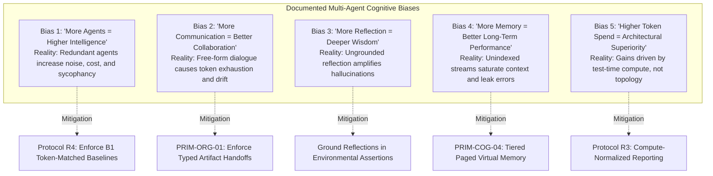

# DR-10: Candidate Baseline Matrix
**Curo Deep Research Investigation — Formal Operational Baseline Hierarchy & Ablation Framework**  
**Document ID**: `DR-10`  
**Document Version**: 1.0.0-FINAL  
**Lifecycle State**: `RESEARCH_AUTHORIZED` | **Implementation Authority**: `NOT_GRANTED`  
**Classification**: Formal Research Deliverable (Tier 1)  
**Author**: `curo_worker_1` (Primitive & Evidence Deliverables Author)  
**Verification Baseline**: `curo_explorer_2` (Primitives & Baseline Discipline), `curo_explorer_3` (Failures)  

---

## 1. Executive Summary & Baseline Invariant

The **Candidate Baseline Matrix (DR-10)** operationalizes **Protocol R4 (Baseline Discipline)** of the Curo Research Charter. Multi-agent systems and adaptive topologies must never be compared solely against one another. To prevent architectural self-deception and ungrounded complexity, every proposed mechanism must be benchmarked against the simplest viable baseline holding foundation model family, parameter scale, context window, and test-time compute budget constant.

### The Baseline Invariant:
> An architectural mechanism (reflection trees, dynamic recruitment, multi-agent debate, or learned orchestration) cannot be declared effective or superior unless it demonstrably outperforms simpler baselines (B0, B1, or B2) when normalized for total inference tokens and wall-clock compute.

---

## 2. Formal Operational Baseline Definitions

SimLab defines a rigorous five-tier baseline hierarchy (B0 through B4):

```
+-----------------------------------------------------------------------------------+
| [B0] Deterministic Agent     | Rule-based FSM, heuristic, zero LLM reasoning      |
|                              | Establish theoretical performance & compute floor  |
+------------------------------+----------------------------------------------------+
| [B1] Single LLM Agent        | Standard prompting, CoT, ReAct, Reflexion, SC-k    |
|                              | Compute-matched single-agent control               |
+------------------------------+----------------------------------------------------+
| [B2] Multi-Independent LLM  | Multiple agents in shared world; zero orchestration|
|                              | Isolates social emergence from orchestration       |
+------------------------------+----------------------------------------------------+
| [B3] Fixed-Role Multi-Agent  | Static hand-assigned roles, fixed waterfall SOPs   |
|                              | Measures value of static specialization            |
+------------------------------+----------------------------------------------------+
| [B4] Adaptive Multi-Agent    | Dynamic recruitment, evolving graphs, OS memory    |
|                              | Evaluates runtime structural plasticity            |
+-----------------------------------------------------------------------------------+
```

### 2.1 Baseline B0: Deterministic Agent (Zero LLMs)
- **Operational Definition**: Purely programmatic software agent implemented using finite-state machines (FSMs), behavior trees, rule-based heuristics, or deterministic solvers (e.g., A* pathfinding, compiler linting, relational SQL joins). Employs zero large language model inference calls.
- **Scientific Role**: Establishes the absolute non-LLM performance, latency, and cost floor. Verifies whether generative language models are required at all for the target problem.
- **Implementation Substrate**: Native Python/Rust code; SQLite databases; Cedar policy engines.

### 2.2 Baseline B1: Single LLM Agent (Zero Collaboration)
- **Operational Definition**: A single autonomous LLM instance operating within the environment without peer agents. May be augmented with single-agent prompt techniques:
  - Zero-Shot / Few-Shot Direct Prompting
  - Chain-of-Thought (CoT)
  - Tool-using ReAct loops (Reason + Act)
  - Reflexion (episodic self-critique using external test feedback)
  - Self-Consistency (B1-SC): Test-time compute sampling ($k$ parallel generation attempts with majority voting).
- **Scientific Role**: Isolates the capability of the foundation model and single-agent prompt engineering from multi-agent interaction effects.
- **Inference Normalization Rule**: When comparing B1 against multi-agent systems, B1's test-time compute (sampling count $k$ or Reflexion turns) must equal the total inference calls or token expenditure of the multi-agent system.

### 2.3 Baseline B2: Multiple Independent LLM Agents (Zero Orchestration)
- **Operational Definition**: Multiple LLM agents co-existing within a shared environment. Each agent perceives environmental state, object affordances, and peer broadcasts, but operates with zero predefined role hierarchy, zero centralized coordinator, zero turn-taking rules, and zero structured workflow pipelines.
- **Scientific Role**: Isolates emergent, uncoordinated multi-agent dynamics from formal organizational structures. Measures whether multi-agent collaboration emerges spontaneously or degrades into communication noise and tragedy-of-the-commons resource collapse.

### 2.4 Baseline B3: Fixed-Role Multi-Agent System (Static Workflow)
- **Operational Definition**: Multi-agent system with statically hand-configured roles, predefined communication graphs, and rigid workflow sequences (e.g., standard ChatDev waterfall, MetaGPT SOP pipeline). Role descriptions, responsibilities, and turn-taking topologies are fixed at initialization and do not mutate during execution.
- **Scientific Role**: Measures the net benefit of functional specialization and procedural division of labor compared to single generalist agents (B1) and uncoordinated groups (B2).

### 2.5 Baseline B4: Candidate Adaptive System (Dynamic Plasticity)
- **Operational Definition**: Multi-agent architectures featuring runtime structural plasticity:
  - Dynamic expert persona recruitment based on task shifts (AgentVerse)
  - Learned reinforcement-learning orchestration over reasoning graphs (Puppeteer)
  - Unsupervised peer-rating network pruning (DyLAN)
  - Tiered virtual operating system memory paging (MemGPT / Letta)
- **Scientific Role**: Tests whether runtime topological mutability and learned orchestration justify their substantial compute overhead, training complexity, and instability risks over static pipelines (B3).

---

## 3. Master Baseline Comparison Matrix

| Dimension | B0: Deterministic Agent | B1: Single LLM Agent | B2: Multi-Independent LLM | B3: Fixed-Role Multi-Agent | B4: Candidate Adaptive System |
|---|---|---|---|---|---|
| **Primary Mechanism** | Hardcoded logic & rules | Prompting, CoT, ReAct, SC | Shared environment sensing | Handcrafted roles & SOPs | Dynamic graphs & recruitment |
| **Inference Calls / Task** | **0** | $1 \dots 10$ ($k$ samples) | $N \times \text{turns}$ | $\sum_{i=1}^R \text{turns}_i$ | Dynamically variable |
| **Token Cost Multiplier** | **0.0x** (Baseline) | $1.0\text{x} \dots 5.0\text{x}$ | $5.0\text{x} \dots 20.0\text{x}$ | $5.0\text{x} \dots 15.0\text{x}$ | $8.0\text{x} \dots 50.0\text{x}$ |
| **Wall-Clock Latency** | $< 1\text{ms}$ | $1.0\text{s} \dots 4.0\text{s}$ | Unbound / Contention | $10\text{s} \dots 60\text{s}$ (Sequential) | $15\text{s} \dots 120\text{s}$ |
| **Memory Footprint** | Static FSM tables | Single context window | $N \times \text{context windows}$ | $R \times \text{role contexts}$ | Paged databases & graph state |
| **Governance Surface** | 100% Deterministic | Prompt-only / Guardrails | Unconstrained broadcast | Inter-phase delimiter checks | Dynamic policy masking |
| **Primary Failure Mode** | Rigid rule gaps | Hallucination; context drift | Tragedy of commons; noise | Pipeline brittleness | Orchestration thrashing |
| **Optimal Domain** | Physics, rules, access | Homogeneous reasoning | Open social dilemmas | Decomposable workflows | Non-linear complex search |

### 3.1 Boundary Qualification: Scope of Single-Agent Self-Consistency (B1-SC) Equivalence
While compute-matched Single-Agent Self-Consistency (B1-SC) matches or outperforms multi-agent debate on homogeneous, closed-context reasoning tasks (e.g., GSM8K, MATH, HumanEval) where all agents share the same foundation model and prompt context, B1-SC does **NOT** substitute for multi-agent systems in environments characterized by:
1. **Partitioned Private State**: Distributed environments where individual agents hold disjoint, confidential observation streams or local memory stores that cannot be unified into a single context window.
2. **Asymmetric Specialized External Tools**: Heterogeneous tool allocations where distinct agents operate specialized compilers, sandboxes, linters, or proprietary database connectors exceeding single-agent tool-schema capacity.
3. **Distinct Persona / Adversarial Perspectives**: Multi-role scenarios requiring institutional checks and balances (e.g., independent double-blind code reviewers, adversarial red teams, or compliance monitors) where role separation must be enforced outside stochastic sampling.
4. **Asynchronous Human-in-the-Loop Interaction**: Interactive simulation domains where multiple human operators interact concurrently with domain-specific agent delegates.

---

## 4. Mechanism-to-Baseline Falsification Ledger

To prevent attributing generic compute scaling to architectural mechanisms, every candidate primitive must be evaluated against the simplest falsifying baseline:

| Primitive ID | Primitive Name | Sourced System | Target Baseline | Minimum Falsification Protocol | Condition Where Simpler Baseline Outperforms Mechanism |
|---|---|---|---|---|---|
| **PRIM-COG-01** | Associative Memory Stream | Smallville | **B1** (FIFO Context Buffer) | Test factual recall over 1,000 game ticks | Recent facts are recalled identically by B1 FIFO at $90\%$ lower token cost; flat vector retrieval introduces noisy semantic distractors. |
| **PRIM-COG-02** | Recursive Reflection Trees | Smallville | **B1-SC** (Single CoT + Self-Consistency) | Solve multi-step deduction benchmark with equal token spend | B1-SC achieves equal or superior accuracy without the runaway belief distortions and personality drift of ungrounded reflection. |
| **PRIM-COG-03** | Hierarchical Daily Planning | Smallville | **B0** (Behavior Tree / HTN Planner) | Execute 24-hour routine under resource contention | B0 executes schedules with 100% mathematical precision, zero token cost, zero latency, and zero temporal skew. |
| **PRIM-COG-04** | Tiered Virtual Memory | MemGPT / Letta | **B1** (Native Long-Context, e.g. Claude 200k) | Multi-hop factual retrieval over 50,000 tokens | When full context fits natively within frontier attention windows, native attention avoids multi-step tool-call paging errors. |
| **PRIM-ORG-01** | SOPs with Typed Artifacts | MetaGPT | **B1** (Single Agent with Pydantic Prompts) | Greenfield single-file software task | B1 produces the script in 1 inference pass ($1.5\text{s}$, 800 tokens); B3 SOP requires 5 roles, 5 API calls ($20\text{s}$, 6,500 tokens). |
| **PRIM-ORG-02** | Asymmetric Chat Chains | ChatDev | **B1** (Reflexion Self-Debugging Loop) | Unit test repair benchmark | B1 Reflexion loop resolves compiler bugs with fewer tokens by eliminating bilateral conversational politeness. |
| **PRIM-ORG-03** | Dynamic Expert Recruitment | AgentVerse | **B3** (Fixed Specialized Team) | Standard software engineering suite | Fixed specialized team achieves equal pass@1 at $40\%$ lower token cost by avoiding expensive meta-recruitment prompts. |
| **PRIM-ORG-04** | Learned RL Puppeteer | Puppeteer | **B3** (Static Waterfall Pipeline) | Predictable sequential engineering tasks | B3 executes deterministically with zero policy overhead; Puppeteer policy can suffer out-of-distribution thrashing. |
| **PRIM-ORG-05** | Dynamic Network Pruning | DyLAN | **B1-SC** (Self-Consistency $k=10$) | GSM8K / MATH benchmark with matched token budget | Single-agent Self-Consistency matches or beats DyLAN accuracy without the $O(N^2)$ peer-scoring prompt overhead. |
| **PRIM-COM-04** | Multi-Agent Debate | AgentVerse | **B1-SC** (Self-Consistency with majority voting) | Logic / reasoning benchmarks with equal inference count | On homogeneous closed-context reasoning (GSM8K, MATH) where agents share base models and context, single-agent Self-Consistency matches or outperforms multi-agent debate while avoiding peer sycophancy, groupthink, and the 76%–88% coordination tax. *Scope boundary*: B1-SC does not substitute for multi-agent systems under partitioned private state, asymmetric specialized external tools, or institutional adversarial roles. |
| **PRIM-LRN-01** | Dual-Memory Case Accumulation | Agent Hospital | **B1** (Standard RAG over Medical Textbooks) | Clinical QA examination set | RAG over gold-standard medical textbooks avoids learning noisy or biased heuristics from synthetic patient cases. |
| **PRIM-SIM-02** | Independent Referee / GM | Concordia | **B0** (Deterministic Physics Engine) | Spatial navigation and collision checks | B0 checks physics with 100% accuracy and zero latency; LLM Game Masters exhibit referee bias and hallucinate rules. |
| **PRIM-GOV-02** | Secretary Agent Auditor | WarAgent | **B0** (Deterministic CapBAC / Cedar Engine) | Enforce security rules under adversarial jailbreak prompts | B0 enforces rules deterministically in native code; LLM Secretary Agents can be persuaded or jailbroken. |

### 4.1 Boundary Qualification on Multi-Agent Primitive Falsification
The finding that B1-SC matches or dominates multi-agent debate holds under the strict condition of **homogeneous closed-context reasoning**: when all debating agents share identical underlying model weights, system prompts, and observation data. Under these conditions, multi-agent debate functions merely as an uncoordinated token-expensive sampling mechanism with high sycophancy risk. Conversely, multi-agent architectures retain a decisive, non-substitutable role when:
- Agents operate over **partitioned private data** (information asymmetry where no single agent has full visibility);
- Agents utilize **asymmetric specialized tools or runtime environments**;
- Governance requires **independent adversarial verification** (e.g., Layer G double-blind auditor) rather than intra-prompt self-critique;
- Systems require **concurrent real-time interaction** with multiple human stakeholders across physical or virtual networks.

---

## 5. Audit of Cognitive Biases & Token Traps in Multi-Agent Design

To enforce scientific integrity across all research and evaluation phases, the team must actively guard against five pervasive cognitive biases in the multi-agent literature:



### Detailed Breakdown of Biases:
1. **Bias 1: "More Agents = Better Performance"**: Adding agents increases coordination overhead, communication latency, and probability of cascading error. Multi-agent topologies are justified ONLY when tasks require distinct adversarial incentives, heterogeneous tool access, or physical/spatial concurrency.
2. **Bias 2: "More Communication = Higher Intelligence"**: Free-form natural language chat between agents is the most error-prone and token-expensive coordination medium. True engineering progress involves replacing conversational banter with structured, schema-validated artifacts.
3. **Bias 3: "More Reflection = Greater Wisdom"**: Recursive reflection without external environmental feedback produces a self-reinforcing echo chamber. In Smallville, ungrounded reflections permanently warped agent personalities.
4. **Bias 4: "More Memory = Superior Performance"**: Accumulating vast streams of unindexed historical text degrades retrieval accuracy, introduces semantic distractors, and overflows context windows.
5. **Bias 5: "Higher Token Spend = Architectural Progress"**: Any multi-agent system that claims performance gains while consuming $5\times$ to $20\times$ more tokens must be tested against a token-matched single-agent baseline (B1-SC). If the gain vanishes, the improvement was driven by compute scaling, not architectural design.

---

## 6. Target SimLab Baseline Implementation Guidelines

For all subsequent experimental and reproduction designs:
1. **Mandatory B0 and B1 Controls**: Every experiment comparing multi-agent topologies (B3 or B4) must implement concurrent B0 (deterministic) and B1 (single-agent) controls.
2. **Token-Spend Parity**: For every evaluation task, the token expenditure of B1 (via Self-Consistency or multi-turn Reflexion) must be matched to the token spend of the multi-agent candidate.
3. **Deterministic Governance Floor**: All access control, security boundaries, and environment physics must be resolved by Baseline B0 mechanisms (Cedar / OPA / Docker), never delegated to probabilistic LLM agents.
