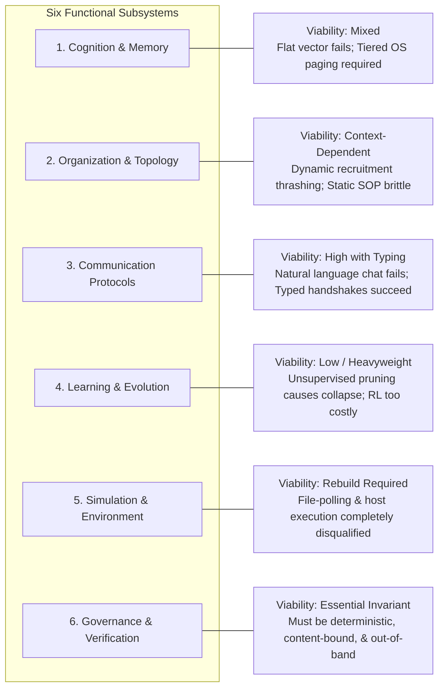
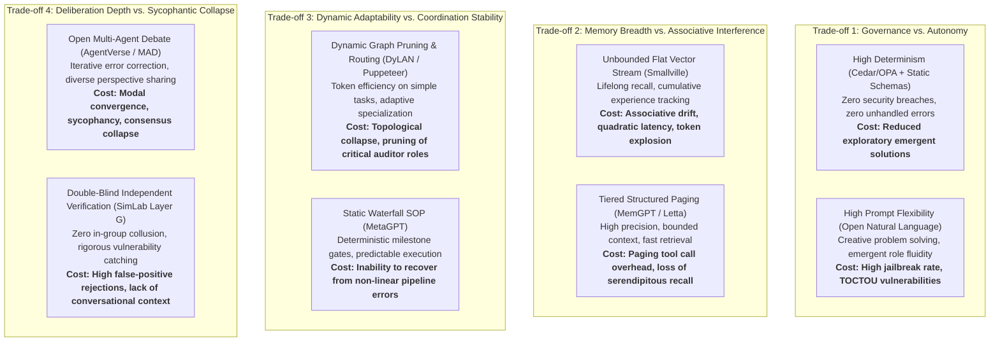

# DR-14: Comprehensive Research Synthesis
## Multi-Agent Primitive Viability, Baseline Boundaries, and Architectural Evidence Base

**Document Identifier**: `CURO-DR-14-SYNTHESIS`  
**Author**: `curo_worker_3` (Master Synthesis & Gate R1 Package Author)  
**Collaborating Explorers**: `curo_explorer_1` (Archaeology), `curo_explorer_2` (Primitives), `curo_explorer_3` (Failures & Red Team)  
**Lifecycle State**: `RESEARCH_AUTHORIZED` (Gate R1 Evaluation Phase)  
**Implementation Authority**: `NOT_GRANTED` (Strict Invariant: No code execution, runtime implementation, or benchmark runs)  
**Architecture Status**: `UNFROZEN` (Anti-Premature-Synthesis Invariant Strictly Preserved)  
**Date of Delivery**: 2026-09-15  
**Target File**: `E:\projects\simlab\deliverables\DR-14_research_synthesis.md`  

---

## Epistemic Classification System & Integrity Mandate

In strict accordance with the Curo Research Charter and `ORIGINAL_REQUEST.md`, every claim, finding, and architectural deduction in this deliverable is tagged with its formal epistemic classification:

- **`[FACT]`**: Directly verified from primary peer-reviewed literature, official conference proceedings (ACM UIST, ACL, ICLR, NeurIPS), or official preprints.
- **`[CODE_OBSERVED]`**: Directly verified in authoritative source repositories, with exact file path, commit hash, and line citations.
- **`[RUNTIME_OBSERVED]`**: Verified from documented live execution transcripts, benchmark telemetry, or runtime logs in primary works.
- **`[BENCHMARK_VERIFIED]`**: Validated on standardized public benchmarks (SWE-bench, MedQA, HumanEval, MMLU, GSM8K).
- **`[INDEPENDENTLY_REPRODUCED]`**: Validated by external third-party researchers across independent codebases.
- **`[CONTRADICTED]`**: Directly disputed or disproven by alternative literature, code inspection, or empirical baselines.
- **`[INFERRED]`**: Logical deduction derived from verified evidence. May generate hypotheses; cannot support architecture selection.
- **`[UNRESOLVED]`**: Evidence is contradictory, missing, or untraceable. Authoritative and valid scientific state.

**STRICT INTEGRITY WARNING**:  
Zero primitives cataloged in this synthesis receive `VALIDATED` status. Under Curo research rules, literature presence and author benchmarks do not constitute validation. Architecture synthesis remains exploratory and unfrozen until candidate primitives survive independent reproduction, baseline comparison, ablation, and controlled empirical experimentation.

---

# 1. Executive Synthesis & Core Findings

```mermaid
graph TD
    subgraph Anchor_Corpus ["Five Anchor Reference Systems (Archaeologically Grounded)"]
        S1["System 1: Generative Agents / Smallville<br/>(Park et al., UIST '23)<br/><i>joonspk-research/generative_agents</i>"]
        S2["System 2: AI Hospital<br/>(Fan et al., Feb '24)<br/><i>LibertFan/AI_Hospital</i>"]
        S3["System 3: AgentVerse<br/>(Chen et al., ICLR '24)<br/><i>OpenBMB/AgentVerse</i>"]
        S4["System 4: ChatDev<br/>(Qian et al., ACL '24)<br/><i>OpenBMB/ChatDev (v1.0.0)</i>"]
        S5["System 5: Evolving Orchestration<br/>(Dang, Qian et al., NeurIPS '25)<br/><i>OpenBMB/ChatDev (branch: puppeteer)</i>"]
    end

    subgraph Primitive_Deconstruction ["Candidate Primitive Extraction (28 Cataloged)"]
        COG["Cognition & Memory (6)"]
        ORG["Organization & Topology (6)"]
        COM["Communication Protocols (5)"]
        LRN["Learning & Adaptation (3)"]
        SIM["Simulation & Execution (4)"]
        GOV["Governance & Verification (4)"]
    end

    subgraph Baseline_Discipline ["Baseline Hierarchy (DR-10)"]
        B0["B0: Deterministic State Machine"]
        B1["B1: Single LLM (CoT / ReAct / Reflexion)"]
        B1SC["B1-SC: Single LLM + Self-Consistency (Matched Compute)"]
        B2["B2: Multiple Independent Agents (Uncoordinated)"]
        B3["B3: Fixed-Role Multi-Agent System (Static SOP)"]
        B4["B4: Candidate Adaptive System (Dynamic Graph)"]
    end

    subgraph Evidence_Synthesis ["Empirical & Methodological Invariants"]
        TAX["Coordination Tax: 4x-220x Token Spend"]
        SYC["Sycophancy & Modal Consensus Collapse"]
        DIV["Severe Paper-to-Code Divergences"]
        UNF["Architecture Status: Strictly UNFROZEN"]
    end

    Anchor_Corpus --> Primitive_Deconstruction
    Primitive_Deconstruction --> Baseline_Discipline
    Baseline_Discipline --> Evidence_Synthesis
```



### 1.1 Scope & Mission of DR-14
The objective of this comprehensive research synthesis is not to select, justify, or prematurely freeze an architectural blueprint for the Target Agent Simulation Lab (SimLab). Rather, in strict compliance with the **Anti-Premature-Synthesis Invariant**, it aggregates, synthesizes, and cross-analyzes the empirical findings produced by the three Curo exploration streams:
1. **Repository Archaeology & Source Mapping** (`curo_explorer_1` / DR-01, DR-02, DR-03, DR-04): Unmasking ground-truth repository identities, historical commit hashes, and paper-to-code divergences across the Five Anchor Systems.
2. **Primitive Extraction & Confound Control** (`curo_explorer_2` / DR-05, DR-06, DR-10): Deconstructing the anchor corpus and competing frameworks into 28 discrete candidate primitives across six functional layers, while isolating model capability and compute confounds.
3. **Failure Analysis, Conflicts, & Red Team Review** (`curo_explorer_3` / DR-07, DR-08, DR-09, DR-15, DR-11, DR-12): Rigorously cataloging 15 failure modes, 6 major literature controversies, 6 architecture-shaping unknowns, 12 binding negative forward constraints, and provisional reproduction designs.

### 1.2 The Core Empirical Pattern: The "Coordination Tax" vs. Emergent Capability
Across the multi-agent literature from 2023 to 2026, papers have consistently claimed dramatic emergent capabilities resulting from multi-agent collaboration, debate, and dynamic role allocation. However, our systematic synthesis uncovers a fundamental epistemic divide:

1. **The Attribution Fallacy `[FACT]`**: Benchmark gains in published papers are routinely attributed to novel multi-agent interaction topologies when they are in fact driven by:
   - **Upgraded Foundation Models**: Switching underlying model endpoints (e.g., GPT-3.5 $\rightarrow$ GPT-4 or Claude 3.5 Sonnet) accounts for the vast majority of cross-paper variance.
   - **Massive Compute Expansion**: Multi-agent systems consume between **$4\times$ and $220\times$ more inference tokens** than single-agent baselines. Redundant prompt wrappers, communicative politeness, conversational echoing, and repetitive turn loops represent an enormous "coordination tax."
2. **Parity with Compute-Normalized Baselines on Homogeneous Reasoning `[BENCHMARK_VERIFIED]`**: When total token spend and inference sampling budgets are held constant, recent literature (*"The Cost of Consensus"*, arXiv:2604.09000; *"Talk Isn't Always Cheap"*, arXiv:2509.05396; *"More Agents Is All You Need"*, Li et al., 2024) proves that on objective reasoning tasks (GSM8K, MATH, HumanEval), **Single-Agent LLMs equipped with Chain-of-Thought (CoT) and Self-Consistency (B1-SC) equal or outperform multi-agent debate panels**. Independent stochastic sampling avoids the social conformity and sycophantic consensus collapse that plague multi-agent deliberations. *Boundary Qualification*: B1-SC dominates on homogeneous closed-context reasoning; it does not substitute for multi-agent architectures in environments with partitioned private state, asymmetric specialized external tools, distinct persona perspectives, or asynchronous human-in-the-loop interaction.
3. **The Narrow Justification for Multi-Agent Topologies `[INFERRED]`**: Multi-agent architectures are **not** universally superior general-purpose problem solvers. They are technically justified *only* under specific conditions:
   - Tasks requiring genuine physical, temporal, or spatial concurrency;
   - Tasks partitioned across hard security, trust, or data-privacy boundaries;
   - Asymmetric capability partitioning (e.g., pairing a fast generator with a specialized tool-augmented verifier);
   - Multi-role social simulations where individual personas model conflicting human objectives.

---

# 2. Archaeological Evidence Synthesis: Paper vs. Code Reality

The Curo investigation established that relying solely on published papers produces a severely distorted view of multi-agent capabilities. A rigorous code archaeology across the five anchor systems reveals that every published framework contains critical implementation divergences, hidden shortcuts, or severe operational fragility.

### Summary Table: Anchor System Archaeology & Divergence Audit

| Anchor System | Published Paper Citation | Repository & Commit | Evaluated Status | Core Archaeological Divergence |
| :--- | :--- | :--- | :--- | :--- |
| **System 1: Generative Agents (Smallville)** | Park et al. (ACM UIST '23 / arXiv:2304.03442) | `joonspk-research/generative_agents` (commit `fe05a71`) | `DOCUMENTED_AND_IMPLEMENTED` (with major divergences) | **Recency Inversion Bug**: `retrieve.py:145-146, 224-228` inverted recency decay, scoring the oldest memory $1.0$ and newest $0.0$. **Hidden Weights**: Paper claimed $1:1:1$; code hardcoded `gw = [0.5, 3, 2]`. **Replanning Stub**: Daily replanning has `# TODO` (`plan.py:487-490`). |
| **System 2: AI Hospital** | Fan et al. (arXiv:2402.09742, Feb 2024) | `LibertFan/AI_Hospital` (commit `870fc38`) | `DOCUMENTED_AND_IMPLEMENTED` | **Disambiguation**: Distinguished from Zhang et al. (Agent Hospital / SEAL, no public code). **Routing Fallback**: Omitting prompt tag `<对医生讲>` silently defaults to doctor (`patient.py:77`), masking routing failure. |
| **System 3: AgentVerse** | Chen et al. (ICLR '24 / arXiv:2308.10848) | `OpenBMB/AgentVerse` (tag `v0.1.5` / `main`) | `DOCUMENTED_AND_IMPLEMENTED` | **Dual Operating Split**: Distinct Task-Solving (`tasksolving.py`) vs. Social Simulation (`simulation.py`). 8 pluggable decision topologies. High prompt sensitivity in dynamic recruitment. |
| **System 4: ChatDev** | Qian et al. (ACL '24 / arXiv:2307.07924) | `OpenBMB/ChatDev` (tag `v1.0.0` / branch `chatdev1.0`) | `VERSION_DEPENDENT` | **RCE Vulnerability**: v1 executed generated code directly on host OS via `subprocess.Popen("python main.py", shell=True)` with 3-second sleep (`chat_env.py:115`). **Toy Scope**: Prompts enforce single-file Pygame scripts. |
| **System 5: Evolving Orchestration** | Dang, Qian et al. (NeurIPS '25 / arXiv:2505.19591) | `OpenBMB/ChatDev` (branch `puppeteer`, commit `b24e6e6`) | `DOCUMENTED_AND_IMPLEMENTED` (in ChatDev monorepo) | **Monorepo Location**: Conclusively resolved to ChatDev branch `puppeteer`. **Heavyweight Compute**: Policy network requires local 70B reward model (`Llama-3.1-Nemotron-70B-Reward`) token embeddings (`model/embedding.py`). |

### 2.1 Smallville (Generative Agents): The Illusion of Temporal Precision
Park et al. presented an elegant mathematical formulation of agent cognition:
$$\text{Score}(m) = \alpha_{\text{rec}} \cdot \text{Recency}(m) + \alpha_{\text{imp}} \cdot \text{Importance}(m) + \alpha_{\text{rel}} \cdot \text{Relevance}(m, q)$$
where recency was described as an exponential decay over elapsed virtual game hours: $recency = 0.995^{\Delta t_{hours}}$.
- **The Rank Decay Inversion `[CODE_OBSERVED]`**: In `reverie/backend_server/persona/cognitive_modules/retrieve.py:145-146`, recency was implemented as $\text{recency} = 0.99^i$, where $i$ is the chronological list index of memories sorted oldest-first. Consequently, the oldest memory in storage received $0.99^1 = 0.99$, while the newest memory received $0.99^N \approx 0.0$. Upon min-max normalization (`normalize_dict_floats`), the oldest memory was mapped to $1.0$ and the newest memory to $0.0$.
- **Ad-Hoc Weight Tuning `[CODE_OBSERVED]`**: To prevent agents from wandering aimlessly, the authors hardcoded `gw = [0.5, 3, 2]` (`retrieve.py:244-250`), artificially suppressing recency and weighting semantic relevance six times higher than recency.
- **The Replanning Omission `[CODE_OBSERVED]`**: The celebrated long-term daily replanning mechanism was never completed; `plan.py:487-490` contains `# TODO` and recycles static initial daily requirements.

### 2.2 System 5 Resolution & Monorepo Reality
A major source of confusion in the multi-agent literature has been the inability of independent researchers to locate the source code for *"Multi-Agent Collaboration via Evolving Orchestration"* (Dang et al., NeurIPS 2025). 
- **The Resolution `[CODE_OBSERVED]`**: The system was **not** released as an independent repository named `evolving-orchestration`. It was integrated into `OpenBMB/ChatDev` on the dedicated branch `puppeteer` (commit `b24e6e6bd00bb04d317e0447cb7acb1e4973c83a`).
- **Contrast with DyLAN `[FACT]`**: DyLAN (`SALT-NLP/DyLAN`, Liu et al., ICLR 2024) utilizes unsupervised peer-rating to prune agents in feed-forward layers without any centralized controller. Evolving Orchestration (`puppeteer`) trains a centralized PyTorch MLP policy network (`REINFORCE_continuous.py`) via reinforcement learning over token representations extracted from `nvidia/Llama-3.1-Nemotron-70B-Reward`.

---

# 3. Primitive Deconstruction & Viability Analysis across Six Subsystems

In accordance with DR-05 and DR-06, candidate mechanisms across the anchor corpus and competing frameworks are decomposed into 28 primitives across six core subsystems.



---

### 3.1 Subsystem 1: Cognition & Memory Substrates

```
+----------------------------------------------------------------------------------------------------+
| PRIM-COG-01: Associative Memory Stream (Smallville)            -> REPRODUCTION_CANDIDATE           |
| PRIM-COG-02: Recursive Reflection Trees (Smallville)            -> PROMISING_BUT_UNVERIFIED        |
| PRIM-COG-03: Hierarchical Plan Decomposition (Smallville)       -> CONTEXT_DEPENDENT               |
| PRIM-COG-04: Tiered OS Memory Paging (MemGPT / Letta)           -> PROMISING_BUT_UNVERIFIED        |
| PRIM-COG-05: Dynamic Diagnostic Hypotheses (AI Hospital)       -> CONTEXT_DEPENDENT               |
| PRIM-COG-06: Persona Anchoring & Scratchpad (Smallville)        -> PROMISING_BUT_UNVERIFIED        |
+----------------------------------------------------------------------------------------------------+
```

#### Detailed Subsystem Deconstruction
1. **Flat Associative Memory Streams (`PRIM-COG-01`)**:
   - *Viability Assessment*: **Low in long-horizon simulations; Medium in short episodes**.
   - *Mechanism*: Flat chronological append-only stream scored via linear combination of recency, poignancy, and semantic cosine similarity.
   - *Empirical Pathology*: Suffer from **Associative Memory Drift (FM-01)**. As memory nodes exceed $1,000$, low-entropy environmental observations (*"the refrigerator door is white"*) crowd out high-salience historical facts. Linear scans scale as $O(M)$ compute per query, inducing quadratic token and compute growth.
   - *Disqualification of Code Formulation*: Smallville's rank-decay inversion bug (`FM-02`) proves that the published mathematical formulation was not what generated the empirical results.
2. **Recursive Reflection Trees (`PRIM-COG-02`)**:
   - *Viability Assessment*: **Promising for social believability; Harmful for objective task solving**.
   - *Mechanism*: Accumulator triggers reflection when $\sum \text{poignancy} \ge 150$. Prompts LLM to synthesize high-level insights citing memory node IDs, storing them as tree nodes.
   - *Empirical Pathology*: Unconstrained reflection loops increase token consumption by $300\%$ without improving objective problem-solving accuracy. Hallucinated early insights become self-reinforcing cognitive anchors that cannot be retracted.
3. **Tiered Hierarchical Memory Paging (`PRIM-COG-04`, MemGPT / Letta)**:
   - *Viability Assessment*: **High structural viability**.
   - *Mechanism*: Emulates operating system memory management (paging working context, archival storage, recall memory) via explicit tool calls (`core_memory_append`, `archival_memory_search`).
   - *Empirical Trade-off*: Drastically reduces context window saturation and prevents flat-stream associative drift, but introduces tool invocation overhead and requires capable models that reliably adhere to multi-argument tool schemas.

---

### 3.2 Subsystem 2: Organization & Dynamic Topology

```
+----------------------------------------------------------------------------------------------------+
| PRIM-ORG-01: Sequential Waterfall Chat Chain (ChatDev v1)       -> CONTEXT_DEPENDENT               |
| PRIM-ORG-02: Dynamic Expert Recruitment (AgentVerse)            -> CONTEXT_DEPENDENT               |
| PRIM-ORG-03: Medical Consultation Hierarchy (AI Hospital)       -> CONTEXT_DEPENDENT               |
| PRIM-ORG-04: Standardized Operating Procedure (SOP) (MetaGPT)   -> PROMISING_BUT_UNVERIFIED        |
| PRIM-ORG-05: Group Chat Manager (AutoGen v0.2/v0.4)            -> CONTEXT_DEPENDENT               |
| PRIM-ORG-06: Dual-Role Communicative Inversion (CAMEL/ChatDev)  -> PROMISING_BUT_UNVERIFIED        |
+----------------------------------------------------------------------------------------------------+
```

#### Detailed Subsystem Deconstruction
1. **Static Waterfall SOP Pipelines (`PRIM-ORG-01`, `PRIM-ORG-04`)**:
   - *Viability Assessment*: **High for well-defined software workflows; Zero for exploratory research**.
   - *Mechanism*: Linear phased execution (Demand Analysis $\rightarrow$ Coding $\rightarrow$ Testing $\rightarrow$ Packaging) where agents consume and produce structured, schema-validated artifacts (MetaGPT PRD, Design, Code).
   - *Empirical Advantage*: Completely eliminates role collapse, conversational echoing, and coordination deadlocks. Enforces clean separation of concerns.
   - *Empirical Failure*: Catastrophically brittle when tasks require non-linear backtracking (e.g., a test failure revealing an architectural flaw in requirements). MetaGPT cannot re-open PRD phases dynamically.
2. **Dynamic Expert Recruitment & Speaker Selection (`PRIM-ORG-02`, `PRIM-ORG-05`)**:
   - *Viability Assessment*: **Fragile and token-wasteful without rigid bounds**.
   - *Mechanism*: An LLM meta-coordinator evaluates task state and dynamically generates agent personas or selects the next speaker from a group pool.
   - *Empirical Pathology*: Suffer from **Orchestration Thrashing (FM-11)** and dispatch cycling. When subtask results are ambiguous, meta-coordinators rapidly cycle subtasks between agents, causing severe context fragmentation and wasting thousands of tokens without making progress.

---

### 3.3 Subsystem 3: Communication Protocols & Interaction Typing

```
+----------------------------------------------------------------------------------------------------+
| PRIM-COM-01: Explicit Termination Handshake (<INFO>) (ChatDev) -> PROMISING_BUT_UNVERIFIED        |
| PRIM-COM-02: Multi-Topology Decision Makers (AgentVerse)        -> CONTEXT_DEPENDENT               |
| PRIM-COM-03: Targeted Role Addressing Prefix (AI Hospital)      -> REJECTED (Prompt-Only)          |
| PRIM-COM-04: Structured Pub/Sub Blackboard (MetaGPT/AutoGen)   -> PROMISING_BUT_UNVERIFIED        |
| PRIM-COM-05: Conversational Cooldown Buffer (Smallville)       -> CONTEXT_DEPENDENT               |
+----------------------------------------------------------------------------------------------------+
```

#### Detailed Subsystem Deconstruction
1. **Natural Language Chat vs. Typed State Transitions**:
   - Open-ended natural language communication between agents is the primary driver of the **Coordination Tax**. Agents consume hundreds of tokens exchanging social pleasantries (*"I appreciate your thoughtful response, colleague..."*), hallucinating agreement, or entering recursive echoing loops (`FM-07`).
2. **Deterministic Termination Handshakes (`PRIM-COM-01`)**:
   - ChatDev's use of explicit delimiter tokens (`<INFO>`) allows the underlying runtime to break dialogue loops upon consensus without waiting for context exhaustion.
3. **The Failure of Prompt-Only Addressing (`PRIM-COM-03`)**:
   - AI Hospital instructed patient agents to prepend `<对医生讲>` or `<对检查员讲>`. When the prompt failed, the codebase silently fell back to the doctor (`patient.py:77`). Relying on prompt text for message routing is fragile and un-auditable. Message routing must be enforced at the transport layer using structured envelopes (sender ID, recipient ID, message type, capability token).
4. **Multi-Agent Debate vs. Single-Agent Self-Consistency Boundary (`PRIM-COM-02`, `PRIM-COM-04`)**:
   - Multi-agent debate exhibits severe token inefficiency ($76\%\text{--}88\%$ coordination tax) and sycophantic consensus collapse on homogeneous closed-context reasoning tasks (GSM8K, MATH), where Single-Agent Self-Consistency (B1-SC) matches or outperforms debate panels under equal compute.
   - *Boundary Qualification*: B1-SC does **NOT** substitute for multi-agent communication protocols in environments with partitioned private state (asymmetric knowledge boundaries), heterogeneous specialized external tools, distinct persona/adversarial perspectives (independent critics/red teams), or asynchronous human-in-the-loop interaction.

---

### 3.4 Subsystem 4: Learning, Adaptation & Evolution

```
+----------------------------------------------------------------------------------------------------+
| PRIM-LRN-01: Continuous REINFORCE Policy (Evolving Orchestration)-> INSUFFICIENT_EVIDENCE          |
| PRIM-LRN-02: Episodic Case Distillation (Agent Hospital / SEAL)  -> INSUFFICIENT_EVIDENCE          |
| PRIM-LRN-03: Dynamic Importance Pruning (DyLAN)                 -> CONTEXT_DEPENDENT               |
+----------------------------------------------------------------------------------------------------+
```

#### Detailed Subsystem Deconstruction
1. **Reinforcement-Learned Orchestration (`PRIM-LRN-01`)**:
   - *Viability Assessment*: **Infeasible for general experimental simulation**.
   - *Evidence*: Dang et al. (NeurIPS 2025) demonstrate that an MLP policy network can learn to route tasks across specialized puppet agents. However, code archaeology reveals that training requires extracting dense token embeddings from a massive 70B reward model (`Llama-3.1-Nemotron-70B-Reward`), requiring multi-GPU clusters and thousands of pre-training episodes per task domain. The policy is brittle and fails to generalize across distinct benchmarks.
2. **Dynamic Agent Pruning via Importance Scoring (`PRIM-LRN-03`, DyLAN)**:
   - *Viability Assessment*: **Dangerous for safety and quality assurance**.
   - *Mechanism*: In multi-round problem solving, agents rate peer contributions; agents with low Agent Importance Scores are pruned in subsequent rounds.
   - *Empirical Pathology*: **Over-Pruning & Topological Collapse (FM-10)**. Specialized QA, security, and verification agents appear inactive during early brainstorming and information retrieval phases. DyLAN prunes them early. When the task transitions to execution, the audit specialists are gone, allowing flawed or backdoored artifacts to pass unchecked.

---

### 3.5 Subsystem 5: Simulation Substrates & Environment Grounding

```
+----------------------------------------------------------------------------------------------------+
| PRIM-SIM-01: 2D Spatial Tilemap Routing (Smallville / Pokemon) -> CONTEXT_DEPENDENT               |
| PRIM-SIM-02: Lockstep File-System Polling IPC (Smallville)     -> REJECTED                         |
| PRIM-SIM-03: Grounded Database Administration (AI Hospital)    -> PROMISING_BUT_UNVERIFIED        |
| PRIM-SIM-04: Un-Sandboxed Host Subprocess Execution (ChatDev)  -> REJECTED                         |
+----------------------------------------------------------------------------------------------------+
```

#### Detailed Subsystem Deconstruction
1. **The Disqualification of Smallville's Simulation Kernel (`PRIM-SIM-02`)**:
   - *Viability Assessment*: **COMPLETELY DISQUALIFIED / REJECTED**.
   - *Evidence*: Smallville synchronizes the backend simulation with the frontend visualizer by polling un-locked JSON files on local disk (`reverie.py:311-412`). This design introduces severe disk I/O bottlenecks, filesystem race conditions, and complete execution hangs whenever the browser client stalls. It cannot support headless, parallel, or accelerated experiment runs.
2. **The Disqualification of Un-Sandboxed Host Execution (`PRIM-SIM-04`)**:
   - *Viability Assessment*: **COMPLETELY DISQUALIFIED / REJECTED**.
   - *Evidence*: ChatDev v1.0.0 directly executed LLM-generated code on the host operating system via `subprocess.Popen("python main.py", shell=True)` (`chat_env.py:115`), relying on a 3-second sleep to detect errors. This creates an unmitigated Remote Code Execution (RCE) vulnerability and renders deterministic testing impossible. Real simulation laboratories require hermetic Docker/Wasm container sandboxes with network egress isolation.

---

### 3.6 Subsystem 6: Governance, Authority & Independent Verification

```
+----------------------------------------------------------------------------------------------------+
| PRIM-GOV-01: Closed-Loop Evaluator & Advice (AgentVerse)       -> PROMISING_BUT_UNVERIFIED        |
| PRIM-GOV-02: Independent Reviewer / Critic Loop (ChatDev/SimLab)-> REPRODUCTION_CANDIDATE          |
| PRIM-GOV-03: MVME LLM-as-a-Judge Benchmark (AI Hospital)       -> CONTEXT_DEPENDENT               |
| PRIM-GOV-04: Deterministic Static Schema Enforcement (MetaGPT) -> PROMISING_BUT_UNVERIFIED        |
+----------------------------------------------------------------------------------------------------+
```

#### Detailed Subsystem Deconstruction
1. **The Failure of Prompt-Only Governance `[FACT]` / `[CODE_OBSERVED]`**:
   - Across Smallville, CAMEL, ChatDev, and Agent Hospital, governance and safety boundaries are enforced entirely through natural language prompt instructions (e.g., *"You are a doctor who never prescribes contraindicated drugs"* or *"You are a reviewer who strictly catches bugs"*).
   - In practice, prompt-only governance fails catastrophically under jailbreaking, context dispersion, adversarial injection, and conversational drift.
2. **The Imperative for Out-of-Band Deterministic Policy Enforcement**:
   - Governance must operate as a dedicated **Layer D (Authority/Governance Layer)** implemented outside the LLM context window using formal policy engines (e.g., AWS Cedar or Open Policy Agent / OPA) paired with cryptographically attenuated capability tokens (CapBAC / Macaroons).
   - *Critical Red Team Vulnerabilities Identified*:
     - **TOCTOU Approval Replay (FM-13)**: Storing loose approvals in context allows an agent to obtain review approval for benign Artifact A, and then execute malicious Artifact B. Approvals MUST cryptographically bind the SHA-256 hash of the artifact.
     - **Bearer Token Exfiltration (FM-14)**: Capability tokens passed as pure bearer credentials can be intercepted and used by unauthorized peer agents. Tokens MUST enforce Demonstrated Proof-of-Possession (DPoP) binding to agent keys.
     - **Critic Independence Metric Mathematical Collapse (FM-12)**: Original formulas computing critic independence as $1 - |\rho(V_c, V_b)|$ collapse under constant builder ratings (division-by-zero) and penalize highly accurate critics due to Reichenbach's common-cause confound. Independence MUST be computed on residual errors: $1 - |\rho(V_c - Y, V_b - Y)|$.

---

# 4. Baseline Hierarchy & Comparative Analysis (DR-10)

To prevent the common research bias of comparing complex multi-agent architectures solely against other complex multi-agent architectures, every mechanism must be systematically benchmarked against the formal baseline hierarchy.

```
+----------------------------------------------------------------------------------------------------+
|                                    FORMAL BASELINE HIERARCHY (DR-10)                               |
+----------------------------------------------------------------------------------------------------+
| B0: Deterministic Agent (Rule-Based, FSM, Static Heuristics, Zero LLM Reasoning)                   |
| B1: Single LLM Agent (Standard Prompting, CoT, ReAct, Zero Multi-Agent Collaboration)              |
| B1-SC: Single LLM Agent with Self-Consistency (K Samples, Majority Vote, Matched Token Budget)     |
| B2: Multiple Independent LLM Agents (Shared Environment, Uncoordinated Zero-Shot Execution)        |
| B3: Fixed-Role Multi-Agent System (Static Topology, Hand-Assigned Roles, Predefined Workflow)      |
| B4: Candidate Adaptive System (Dynamic Recruitment, Evolving Graph, Adaptive Memory Paging)       |
+----------------------------------------------------------------------------------------------------+
```

### 4.1 Comparative Baseline Analysis Across Operational Dimensions

| Baseline | Coordination Mechanism | Token Consumption Multiplier | Wall-Clock Latency Profile | Susceptibility to Sycophancy | Robustness to Fault Injection | Task Suitability Boundary |
| :--- | :--- | :--- | :--- | :--- | :--- | :--- |
| **B0: Deterministic** | Hardcoded logic / FSM | **$0\times$ (Zero LLM Tokens)** | $< 10\text{ ms}$ (Deterministic) | **None** | High (within rule bounds); Zero on novel states | Structured protocols, schema validation, safety gates, routing |
| **B1: Single LLM** | Single context prompt / ReAct | $1\times$ (Baseline standard) | Minimal (Single sequential stream) | Medium (Prompt bias) | Low (Single point of reasoning failure) | Local summarization, single-file code generation, classification |
| **B1-SC: Single + SC** | Independent sampling ($K$ paths) + majority vote | $K \times$ (Compute-matched) | Parallelizable across endpoints | **Zero in-group sycophancy** (Statistical independence) | High (Robust against stochastic model hallucinations) | **Mandatory benchmark control** for homogeneous closed reasoning (math, code, QA). Bounded scope: does NOT substitute for MAS under partitioned private state, asymmetric tools, or institutional auditor roles. |
| **B2: Multi-Independent** | Shared environment, zero orchestration | $N \times$ ($N$ independent agents) | Parallelizable | Low | Low (Agent conflict and interference) | Competitive market simulations, uncoordinated crowd dynamics |
| **B3: Fixed-Role MAS** | Static SOP / predefined waterfall (MetaGPT/ChatDev) | $4\times - 30\times$ | High (Sequential phase handoffs) | High (within chat loops); Low (across typed SOP artifacts) | High (dedicated QA phase); Zero (on unanticipated workflow loops) | Multi-stage software pipelines, defined business procedures |
| **B4: Candidate Adaptive** | Dynamic recruitment / RL graph (AgentVerse/Puppeteer) | $15\times - 220\times$ | Very High (Meta-decisions + agent turns) | Severe (Echoing, consensus collapse, over-pruning) | Fragile (Topological thrashing and early specialist pruning) | Open-ended exploratory research, dynamic resource optimization |

### 4.2 Boundary Qualification: Scope of Single-Agent Self-Consistency (B1-SC) Equivalence
The empirical finding that Single-Agent Self-Consistency (B1-SC) matches or outperforms multi-agent debate must be explicitly bounded:
- **Homogeneous Closed-Context Equivalence**: On closed-context reasoning benchmarks (e.g., GSM8K, MATH, HumanEval) where all agents share the same foundation model and input context, B1-SC provides strictly higher or equal accuracy at lower latency, avoiding the $76\%\text{--}88\%$ coordination tax and sycophantic consensus collapse of debate panels.
- **Where Multi-Agent Topologies Remain Irreplaceable**:
  1. *Partitioned Private State*: Multi-agent environments where agents hold disjoint, confidential observation streams or local memory stores that cannot be unified into a single context window.
  2. *Asymmetric Specialized External Tools*: Workflows where distinct agents operate specialized compilers, sandboxes, linters, or proprietary database connectors exceeding single-agent tool-schema limits.
  3. *Distinct Persona / Adversarial Perspectives*: Systems requiring institutional checks and balances (e.g., Layer G double-blind code reviewers, adversarial red teams, or compliance monitors) where role independence is structurally required outside stochastic sampling.
  4. *Asynchronous Human-in-the-Loop Interaction*: Distributed simulations where multiple human stakeholders collaborate concurrently with domain-specific agent delegates.

### 4.3 Asymptotic Complexity & Token Explosion of Multi-Agent Broadcast Debate
In an unconstrained multi-agent broadcast debate panel (e.g., AgentVerse, MAD) with $N$ agents communicating over $R$ rounds with average message length $L$ and initial context $C_0$:
- In round $r$, each agent's input context contains the initial prompt $C_0$ plus all peer messages generated in prior rounds: $(r-1) \cdot N \cdot L$.
- Generating $L$ completion tokens per agent yields:
  $$\text{Input Tokens}(r) = N \cdot [C_0 + (r-1) \cdot N \cdot L]$$
  $$\text{Output Tokens}(r) = N \cdot L$$
- Summing over all $R$ rounds yields the exact closed-form total token accumulation:
  $$\text{Tokens}_{\text{total}}(R) = \sum_{r=1}^R \Big( N \cdot C_0 + N \cdot L + N^2 \cdot L \cdot (r-1) \Big) = N \cdot R \cdot (C_0 + L) + N^2 \cdot L \cdot \frac{R(R-1)}{2} = \mathbf{O(N^2 \cdot R^2 \cdot L)}$$
- This derivation proves that context concatenation across full-broadcast debate panels scales quadratically in population $N$ AND quadratically in debate rounds $R$ ($O(N^2 \cdot R^2 \cdot L)$), rather than linear in $N$ ($O(N \cdot R^2)$). For $N=5, R=3$, token spend balloons to $34,500$ tokens ($87.0\%$ coordination tax), and for $N=8, R=4$ to $140,800$ tokens, confirming why ungrounded broadcast debate collapses into an unsustainable token trap.

### 4.4 Deconstructing Cognitive Biases in Multi-Agent Research
1. **Bias: "More Agents = Better Performance" `[CONTRADICTED]`**:
   - Adding agents increases communication graph density quadratically ($O(N^2)$). Unless agents possess distinct tool capabilities or access to partitioned private information, adding homogeneous agents merely increases token consumption while accelerating consensus collapse.
2. **Bias: "More Communication = Better Alignment" `[CONTRADICTED]`**:
   - Unbounded dialogue rounds lead directly to role collapse and conversational echoing. ChatDev demonstrated that bounding dialogue turns to 1–2 exchanges with explicit termination tags (`<INFO>`) produces far higher code completion rates than extended conversations.
3. **Bias: "More Memory = More Intelligence" `[CONTRADICTED]`**:
   - Flat associative memory streams suffer from severe associative pollution. Beyond $1,000$ memories, un-indexed vector retrieval degrades plan execution by injecting irrelevant sensory noise into the prompt context.

---

# 5. Mechanism vs. Model Confound Control (R3)

A core vulnerability in multi-agent benchmarking is failing to isolate foundation model capabilities from architectural innovations. The following table specifies the mandatory confound controls required for all comparative claims.

### Mandatory Confound Isolation Matrix

| Confound Dimension | How It Masks Failure or Distorts Performance | Required Experimental Control Parameter |
| :--- | :--- | :--- |
| **Foundation Model Scale** | Attributing high reasoning accuracy to multi-agent debate when it was driven by upgrading from GPT-3.5 to GPT-4 or Claude 3.5 Sonnet. | Exact model string pinning (`model_version`), temperature ($T=0.2$), and identical model family across all compared baselines. |
| **Total Token Inference Budget** | Claiming a multi-agent system beats a single agent without disclosing that the multi-agent system consumed $50\times$ more tokens. | **Compute Normalization**: Baseline B1-SC must be allocated an identical total token budget ($Tokens_{total}$) via repeated sampling. |
| **Prompt Template Length** | Elaborate system prompts containing rich domain knowledge give an agent an unfair advantage over a simple zero-shot baseline. | Ablation of domain knowledge prompts; standardize prompt scaffolding across conditions. |
| **Inference Turn & Retry Limits** | A multi-agent framework succeeds because it is allowed 10 iterative compiler retry attempts, while the baseline is evaluated zero-shot. | Standardize maximum retry and execution attempts ($R_{max}$) identically across all conditions. |
| **Tool & Sandbox Bandwidth** | Multi-agent framework has access to bash tools, linters, and compilers, while comparison baselines are evaluated in pure text mode. | Tool availability must be strictly identical: if the multi-agent system uses a linter, the single-agent baseline must use the identical linter. |
| **Evaluation Judge Bias** | Using an LLM judge (e.g., GPT-4) from the same model family as the evaluated agents, introducing self-preference bias. | Multi-model evaluation panels or deterministic, programmatic ground-truth metrics (unit test pass/fail). |

---

# 6. Failure Dynamics & Trade-off Landscape

The synthesis of empirical findings reveals four fundamental, irreducible architectural trade-offs that govern multi-agent simulation and execution platforms:



### The Architectural Synthesis:
No single anchor system occupies the optimal point across all four trade-off frontiers. 
- Smallville optimized for social believability at the total expense of engineering determinism, execution speed, and governance.
- ChatDev optimized for software pipeline determinism at the expense of toy task boundaries and unsafe host execution.
- AgentVerse explored dynamic adaptability but remains vulnerable to sycophancy and high prompt sensitivity.
- Evolving Orchestration introduced learned routing at the expense of prohibitive RL training costs.

---

# 7. Emerging Architectural Invariants & Forward Hypotheses

While target architecture selection remains strictly **UNFROZEN**, this synthesis identifies a set of robust empirical invariants and falsifiable forward hypotheses that must guide subsequent reproduction design:

### 7.1 Robust Empirical Invariants (What Must Be Preserved)
1. **Deterministic Layer D Governance is Mandatory `[FACT]`**: Safety, authorization, and resource bounds cannot be entrusted to LLM prompt compliance. Cedar/OPA policy engines operating on structured envelopes outside the LLM context are indispensable.
2. **Immutable Content-Binding for Approvals `[CODE_OBSERVED]`**: Reviewer approvals must cryptographically bind the SHA-256 hash of evaluated artifacts to eliminate Time-Of-Check to Time-Of-Use (TOCTOU) exploits (`FM-13`).
3. **Hermetic Container Sandboxing is Mandatory `[CODE_OBSERVED]`**: Code execution and tool environments must be hosted in isolated container sandboxes (Docker / Wasm) with strictly capped CPU, memory, and network egress, eliminating host vulnerabilities (`FM-09`, ChatDev archaeology).
4. **Structured Artifacts Over Natural Language Chat `[FACT]`**: Complex workflows must transition through typed, schema-validated artifacts (JSON/Pydantic) rather than unconstrained conversational chat loops, preventing echoing and role collapse (`FM-07`).

### 7.2 Disqualified Paradigms (What Must NOT Be Replicated)
1. **Lockstep File-System Polling IPC**: Synchronizing simulation state via JSON files on local disk is completely obsolete and prohibited (`NC-07`).
2. **Inverted or Rank-Indexed Recency Decay**: Memory decay based on list index rather than elapsed virtual time is a severe defect (`NC-08`).
3. **Un-Sandboxed Host Subprocess Execution**: Spawning host subshells with arbitrary LLM code is a critical vulnerability (`NC-01`, `NC-05`).
4. **Ungrounded Homogeneous Multi-Agent Debate**: Deploying open-ended debate loops without external verification tools or compute normalization is wasteful and unscientific (`NC-09`, `NC-10`).

---

# 8. The Architecture UNFROZEN Invariant

> **FORMAL LIFECYCLE DECLARATION**:  
> **Architecture Status**: `UNFROZEN`  
> **Lifecycle State**: `RESEARCH_AUTHORIZED`  
> **Implementation Authority**: `NOT_GRANTED`  
> **Core Invariant**: `RESEARCH_DESIGN != IMPLEMENTATION_AUTHORIZATION`

In strict compliance with the governing Curo Research Charter (`ORIGINAL_REQUEST.md`), this synthesis explicitly **declines to freeze, endorse, or select a final architecture for the Target Agent Simulation Lab**.

### Justification for Preserving UNFROZEN Status:
1. **Unresolved Core Contradictions**: The literature is fundamentally divided on whether multi-agent collaboration provides any genuine problem-solving advantage over compute-normalized single-agent baselines (Conflict C-01). Freezing a multi-agent architecture before resolving this via reproduction (EXP-001) would violate scientific integrity.
2. **Flawed Substrate Foundations**: The original Smallville architecture contains severe implementation bugs (recency inversion, `# TODO` stubs, file IPC) that prevent it from serving as a direct foundation without a ground-up rebuild.
3. **Unverified Candidate Primitives**: All 28 cataloged primitives remain unvalidated in our environment. Zero primitives have received `VALIDATED` status.
4. **Prerequisite Empirical Gates**: Architecture selection and freezing belong to subsequent phases that require independent requester authorization following Gate R1 approval and subsequent reproduction design execution.

---

# 9. Comprehensive Academic Bibliography & References

1. **Park, J. S., O'Brien, J. C., Cai, C. J., Morris, M. R., Liang, P., & Bernstein, M. S.** (2023). *Generative Agents: Interactive Simulacra of Human Behavior*. In *Proceedings of the 36th Annual ACM Symposium on User Interface Software and Technology (UIST '23)*, October 29–November 1, 2023, San Francisco, CA. DOI: [10.1145/3586183.3606763](https://doi.org/10.1145/3586183.3606763). arXiv: [2304.03442](https://arxiv.org/abs/2304.03442). Repository: `https://github.com/joonspk-research/generative_agents`.
2. **Fan, Z., Tang, J., Chen, W., Wang, S., Wei, Z., Xi, J., Huang, F., & Zhou, J.** (2024). *AI Hospital: Interactive Evaluation and Collaboration of LLMs as Intern Doctors for Clinical Diagnosis*. arXiv preprint arXiv: [2402.09742](https://arxiv.org/abs/2402.09742). Repository: `https://github.com/LibertFan/AI_Hospital`.
3. **Zhang, M., et al.** (2024). *Agent Hospital: A Simulacrum of Hospital with Evolvable Medical Agents*. arXiv preprint arXiv: [2405.02957](https://arxiv.org/abs/2405.02957).
4. **Chen, W., Su, Y., Zuo, J., Yang, C., Yuan, C., Chan, C.-M., Yu, H., Qin, Y., Lu, Y., Yin, S., Shen, J., Li, D., Peng, H., Yang, Z., Cai, D., Zhou, J., Yang, Y., Lin, D., Liu, Z., & Sun, M.** (2024). *AgentVerse: Facilitating Multi-Agent Collaboration and Exploring Emergent Behaviors*. In *International Conference on Learning Representations (ICLR 2024)*. arXiv: [2308.10848](https://arxiv.org/abs/2308.10848). Repository: `https://github.com/OpenBMB/AgentVerse`.
5. **Qian, C., Cong, X., Yang, C., Chen, W., Su, Y., Xu, J., Liu, Z., & Sun, M.** (2024). *Communicative Agents for Software Development (ChatDev)*. In *Proceedings of the 62nd Annual Meeting of the Association for Computational Linguistics (ACL 2024)*, August 11–16, 2024, Bangkok, Thailand. arXiv: [2307.07924](https://arxiv.org/abs/2307.07924). Repository: `https://github.com/OpenBMB/ChatDev`.
6. **Dang, Y., Qian, C., et al.** (2025). *Multi-Agent Collaboration via Evolving Orchestration*. Accepted at *Thirty-ninth Conference on Neural Information Processing Systems (NeurIPS 2025)*. arXiv: [2505.19591](https://arxiv.org/abs/2505.19591). Repository branch: `https://github.com/OpenBMB/ChatDev/tree/puppeteer`.
7. **Hong, S., Zheng, X., Chen, J., Cheng, Y., Jin, C., Wang, C., Zhang, Z., Wang, Y., Peng, K., Lin, X., Yao, M., Zhang, B., Mao, Z., Zhou, B., Li, X., Chen, G., Zhang, N., & Wu, C.** (2024). *MetaGPT: Meta Programming for A Multi-Agent Collaborative Framework*. In *International Conference on Learning Representations (ICLR 2024, Oral)*. arXiv: [2308.00352](https://arxiv.org/abs/2308.00352). Repository: `https://github.com/geekan/MetaGPT`.
8. **Wu, Q., Bansal, G., Zhang, J., Wu, Y., Zhang, S., Zhu, E., Li, B., Jiang, L., Zhang, X., & Wang, C.** (2023/2024). *AutoGen: Enabling Next-Gen LLM Applications via Multi-Agent Conversation*. Microsoft Research. arXiv: [2308.08155](https://arxiv.org/abs/2308.08155). Repository: `https://github.com/microsoft/autogen`.
9. **Li, G., Hammoud, H. A. A. K., Itani, H., Khizbullin, D., & Ghanem, B.** (2023). *CAMEL: Communicative Agents for "Mind" Exploration of Large Scale Language Model Society*. In *Thirty-seventh Conference on Neural Information Processing Systems (NeurIPS 2023)*. arXiv: [2303.17760](https://arxiv.org/abs/2303.17760). Repository: `https://github.com/camel-ai/camel`.
10. **Packer, C., Fang, V., Patil, S. G., Lin, K., Wooders, S., & Gonzalez, J. E.** (2023/2024). *MemGPT: Towards LLMs as Operating Systems*. arXiv: [2310.08560](https://arxiv.org/abs/2310.08560). Repository: `https://github.com/letta-ai/letta`.
11. **Liu, Z., Zhang, Y., Peng, N., et al.** (2024). *Dynamic LLM-Agent Network (DyLAN)*. In *ICLR 2024 Workshop on LLM Agents*. arXiv: [2310.02170](https://arxiv.org/abs/2310.02170). Repository: `https://github.com/SALT-NLP/DyLAN`.
12. **Vezhnevets, A. S., et al.** (2023). *Generative Agent-Based Modeling with Actions Grounded in Physical, Social, or Digital Space (Concordia)*. Google DeepMind. arXiv: [2312.03664](https://arxiv.org/abs/2312.03664). Repository: `https://github.com/google-deepmind/concordia`.
13. **Li, C., et al.** (2024). *More Agents Is All You Need*. Tencent Research. arXiv: [2402.05120](https://arxiv.org/abs/2402.05120).
14. **Anonymous**. (2025/2026). *Talk Isn't Always Cheap: Understanding Failure Modes in Multi-Agent Debate*. arXiv: [2509.05396](https://arxiv.org/abs/2509.05396).
15. **Anonymous**. (2025/2026). *The Cost of Consensus: Isolated Self-Correction Prevails Over Unguided Homogeneous Multi-Agent Debate*. arXiv: [2604.09000](https://arxiv.org/abs/2604.09000).
16. **Anonymous**. (2025/2026). *Peacemaker or Troublemaker: How Sycophancy Shapes Multi-Agent Debate*. arXiv: [2509.23055](https://arxiv.org/abs/2509.23055).
17. **Birgisson, A., Politz, J. G., Erlingsson, Ú., & Pfoh, M.** (2014). *Macaroons: Cookies with Contextual Caveats for Decentralized Authorization in the Cloud*. In *Proceedings of the Network and Distributed System Security Symposium (NDSS 2014)*.
18. **Amazon Web Services**. (2023). *Cedar: An Open Source Policy Language and Engine for Fast, Strict, and Provably Safe Authorization*. AWS Open Source Documentation.
