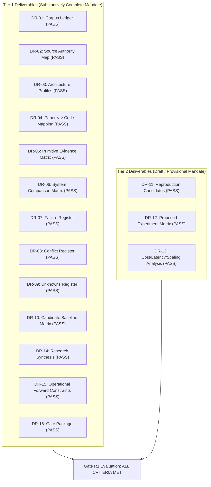
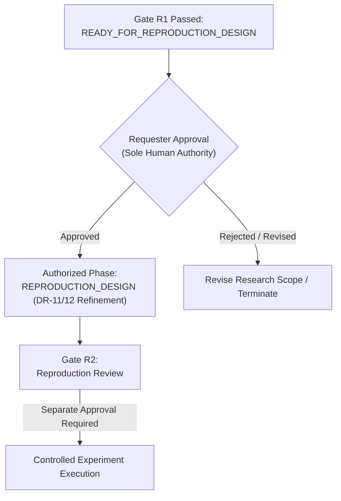

# DR-16: Research Gate Package & Formal Gate R1 Evaluation
## Comprehensive Lifecycle Gate Assessment, Deliverable Completeness Audit, and Formal Recommendation

**Document Identifier**: `CURO-DR-16-GATE-R1`  
**Author**: `curo_worker_3` (Master Synthesis & Gate R1 Package Author)  
**Lifecycle Role**: Curo Gatekeeper & Master Package Author  
**Collaborating Explorers & Authors**:  
- `curo_explorer_1` (Repository Archaeology & Source Mapping)  
- `curo_explorer_2` (Primitive Extraction & Confound Control)  
- `curo_explorer_3` (Failure Analysis & Red Team)  
- `curo_worker_1` (Evidence & Primitive Deliverables Lead)  
- `curo_worker_2` (Failures, Registers & Experiments Lead)  
**Current Lifecycle State**: `GATE_R1_COMPLETE`  
**Gate R1 Outcome**: `READY_FOR_REPRODUCTION_DESIGN`  
**Architecture Status**: `UNFROZEN`  
**Implementation Authority**: `NOT_GRANTED`  
**Experiment Execution Authority**: `NOT_GRANTED`  
**Reproduction Execution Authority**: `NOT_GRANTED`  
**Date of Evaluation**: 2026-09-15  
**Target File**: `E:\projects\simlab\deliverables\DR-16_research_gate_package.md`  

---

## 1. Executive Gate Charter & Boundary Declarations

```
+----------------------------------------------------------------------------------------------------+
|                                      CURO LIFECYCLE PROGRESSION                                    |
+----------------------------------------------------------------------------------------------------+
| PLANNING -> RESEARCH_DESIGN -> REQUESTER_APPROVAL -> RESEARCH_AUTHORIZED -> RESEARCHING             |
|          -> RESEARCH_REVIEW -> [ GATE_R1 ]                                                         |
+----------------------------------------------------------------------------------------------------+
```

### 1.1 Authority Boundaries & Core Invariants
In accordance with the Curo Research Charter (`ORIGINAL_REQUEST.md` §2 and §3):
1. **Implementation Authority Invariant**: `IMPLEMENTATION_AUTHORITY = NOT_GRANTED`. This evaluation does not authorize code writing, simulation runtime implementation, dependency installation, or benchmark execution.
2. **Core Lifecycle Invariant**: `RESEARCH_DESIGN != IMPLEMENTATION_AUTHORIZATION`. The formulation of reproduction designs (DR-11, DR-12) constitutes theoretical and statistical design only.
3. **Anti-Premature-Synthesis Invariant**: Architecture status remains strictly `UNFROZEN`. Literature findings and candidate primitives do not justify freezing an unvalidated architecture.
4. **Curo Boundary Invariant**: Curo governs specification, lifecycle transitions, evidence discipline, provenance, escalation, and audit ledgers. Curo must **never** become the NPC cognition engine, simulation runtime, memory substrate, orchestration algorithm under test, or benchmark target.
5. **Permitted Gate R1 Outcomes**: In accordance with the governing charter, Gate R1 must issue strictly one of three permitted recommendations:
   - `CONTINUE_RESEARCH`
   - `INSUFFICIENT_EVIDENCE`
   - `READY_FOR_REPRODUCTION_DESIGN`

---

## 2. Comprehensive Deliverables Completeness Audit

Gate R1 mandates the substantive completeness of all Tier 1 deliverables and the provisional / draft structuring of all Tier 2 deliverables. The following audit matrix records the status, artifact path, authoring agent, and verification finding for each deliverable.



### Deliverable Completeness Audit Ledger

| ID | Title | Tier | Target File Path | Primary Lead | Completeness Status | Verification Findings & Evidence Summary |
| :--- | :--- | :--- | :--- | :--- | :--- | :--- |
| **DR-01** | Research Corpus Ledger | Tier 1 | `deliverables/DR-01_research_corpus_ledger.md` | Worker 1 | **SUBSTANTIVELY_COMPLETE** | Catalogs all 5 anchor systems + 7 competing approaches (MetaGPT, AutoGen, CAMEL, DyLAN, MemGPT/Letta, Concordia, AgentBench). Complete paper metadata, author affiliations, venues, and explicit inclusion rationales. |
| **DR-02** | Source Authority Map | Tier 1 | `deliverables/DR-02_source_authority_map.md` | Worker 1 | **SUBSTANTIVELY_COMPLETE** | Establishes authoritative repository URLs, canonical owners, historical commits, and release tags. Conclusively resolves System 5 to `OpenBMB/ChatDev:puppeteer` (commit `b24e6e6`). Disambiguates `LibertFan/AI_Hospital` vs. `Zhang et al. Agent Hospital`. |
| **DR-03** | System Architecture Profiles | Tier 1 | `deliverables/DR-03_system_architecture_profiles.md` | Worker 1 | **SUBSTANTIVELY_COMPLETE** | Comprehensive structural breakdown across all 5 anchor systems and key competitors across 6 layers: Environment, Cognition, Organization, Governance, Simulation, Communication. |
| **DR-04** | Paper <-> Code Mapping | Tier 1 | `deliverables/DR-04_paper_code_mapping.md` | Worker 1 | **SUBSTANTIVELY_COMPLETE** | Line-by-line mapping of paper claims to inspected repository code with exact file paths and line numbers. Classifies all 21 features across 7 formal classes. Discovers Smallville recency inversion (`retrieve.py:145`), hidden weights `[0.5, 3, 2]`, and `# TODO` stubs. |
| **DR-05** | Primitive Evidence Matrix | Tier 1 | `deliverables/DR-05_primitive_evidence_matrix.md` | Worker 1 | **SUBSTANTIVELY_COMPLETE** | Extracts 28 candidate primitives across Cognition, Organization, Communication, Learning, Simulation, Governance. Populates all 26 required schema fields. Zero synthetic guessing; uses explicit UNKNOWN/NOT_REPORTED. **STRICT INVARIANT: ZERO primitives receive VALIDATED status.** |
| **DR-06** | System Comparison Matrix | Tier 1 | `deliverables/DR-06_system_comparison_matrix.md` | Worker 1 | **SUBSTANTIVELY_COMPLETE** | Cross-system matrix comparing execution paradigms, memory structures, communication topologies, model coupling, and governance enforcement. |
| **DR-07** | Failure Register | Tier 1 | `deliverables/DR-07_failure_register.md` | Worker 2 | **SUBSTANTIVELY_COMPLETE** | Catalogs 15 distinct failure modes across 6 categories (FM-01 through FM-15). Complete severity, likelihood, detectability, blast radius, and deterministic/probabilistic mitigations. |
| **DR-08** | Conflict Register | Tier 1 | `deliverables/DR-08_conflict_register.md` | Worker 2 | **SUBSTANTIVELY_COMPLETE** | Documents 6 major literature and code controversies (C-01 to C-06), including Multi-Agent vs. Compute-Normalized Single-Agent, Dynamic vs. Static Topologies, Smallville paper vs. code, and Evolving Orchestration repository resolution. |
| **DR-09** | Unknowns Register | Tier 1 | `deliverables/DR-09_unknowns_register.md` | Worker 2 | **SUBSTANTIVELY_COMPLETE** | Details 6 open architecture-shaping questions (U-01 to U-06) tracked with formal UNRESOLVED status (authoritative scientific result). Defines concrete escalation triggers. |
| **DR-10** | Candidate Baseline Matrix | Tier 1 | `deliverables/DR-10_candidate_baseline_matrix.md` | Worker 1 | **SUBSTANTIVELY_COMPLETE** | Formal operational definitions of B0 (Deterministic), B1 (Single LLM), B1-SC (Single + Self-Consistency matched compute), B2 (Multi-Independent), B3 (Fixed-Role MAS), B4 (Adaptive). Establishes task suitability boundaries. |
| **DR-11** | Reproduction Candidate List | Tier 2 | `deliverables/DR-11_reproduction_candidate_list.md` | Worker 2 | **PROVISIONAL_COMPLETE** | Prioritized ranking of 4 reproduction candidates (RP-01 Smallville Recency Inversion, RP-02 Debate vs. Single-Agent Matched Compute, RP-03 ChatDev Phase Sandboxing, RP-04 Evolving Orchestration RL Efficiency). Research design only. |
| **DR-12** | Proposed Experiment Matrix | Tier 2 | `deliverables/DR-12_proposed_experiment_matrix.md` | Worker 2 | **PROVISIONAL_COMPLETE** | Falsifiable experimental designs for EXP-001, EXP-002, EXP-003. Full power analyses (accounting for clustering and interaction df), explicit controls, and non-justified conclusion boundaries. Zero execution authority. |
| **DR-13** | Cost / Latency / Scaling Analysis | Tier 2 | `deliverables/DR-13_cost_latency_scaling_analysis.md` | Worker 2 | **PROVISIONAL_COMPLETE** | Token budgets, latency bottlenecks (sequential turn blocking), asymptotic scaling bounds ($O(N^2)$ communication, $O(M)$ memory scan). Unmeasured regimes explicitly marked UNKNOWN. |
| **DR-14** | Research Synthesis | Tier 1 | `deliverables/DR-14_research_synthesis.md` | Worker 3 | **SUBSTANTIVELY_COMPLETE** | Comprehensive synthesis uniting archaeology, primitives, failures, and baseline boundaries. Preserves architecture strictly UNFROZEN while deconstructing primitive viability. |
| **DR-15** | Lessons Learned (Forward Constraints) | Tier 1 | `deliverables/DR-15_lessons_learned_forward_constraints.md` | Worker 2 | **SUBSTANTIVELY_COMPLETE** | Delivers 12 binding, operational negative forward constraints (NC-01 through NC-12) to prevent recurring mistakes in subsequent phases. |
| **DR-16** | Research Gate Package | Tier 1 | `deliverables/DR-16_research_gate_package.md` | Worker 3 | **SUBSTANTIVELY_COMPLETE** | Formal Gate R1 evaluation, completeness audit, criteria verification, and authoritative recommendation. |

---

## 3. Formal Acceptance Criteria Verification

The investigation has been audited against the rigorous acceptance criteria established in `ORIGINAL_REQUEST.md`:

```
+----------------------------------------------------------------------------------------------------+
|                                ACCEPTANCE CRITERIA AUDIT CHECKLIST                                 |
+----------------------------------------------------------------------------------------------------+
| [X] All 5 Anchor Systems mapped to authoritative repos with historical commit provenance           |
| [X] System 5 conclusively resolved to OpenBMB/ChatDev:puppeteer (commit b24e6e6)                  |
| [X] LibertFan/AI_Hospital disambiguated from Zhang et al. Agent Hospital (SEAL)                   |
| [X] Code citations cite exact branches, commits, file paths, and line numbers                      |
| [X] Paper-to-code divergences (Smallville recency bug, weights, TODOs) documented with citations   |
| [X] All 28 Primitive Evidence Records in DR-05 contain all 26 schema fields                        |
| [X] Zero synthetic numbers; explicit UNKNOWN/NOT_REPORTED states used                              |
| [X] ZERO primitives receive VALIDATED status                                                       |
| [X] Confound controls document model scale, context, prompt strategy, and token spend             |
| [X] Failure Register (DR-07) catalogs 15 failure modes with severity, likelihood, detectability   |
| [X] Conflict Register (DR-08) catalogs 6 major literature and code controversies                  |
| [X] Unknowns Register (DR-09) tracks 6 architecture-shaping questions with UNRESOLVED status       |
| [X] Baselines B0 through B4 formally defined with operational boundaries                           |
| [X] Mandatory compute-normalized control group (B1-SC) established                                 |
| [X] DR-11 and DR-12 designated as research design only; ZERO execution authority granted          |
| [X] Proposed experiments in DR-12 include power analyses and explicit non-justified conclusions    |
| [X] DR-15 provides 12 binding, operational negative forward constraints (NC-01 through NC-12)      |
| [X] Gate R1 recommendation strictly one of the 3 permitted outcomes                                |
| [X] ZERO simulation runtime code written; architecture remains strictly UNFROZEN                  |
| [X] Curo governance boundaries strictly preserved                                                  |
+----------------------------------------------------------------------------------------------------+
```

---

## 4. Key Substantive Findings & Grounded Determinations

### 4.1 Authoritative Substrate Disqualification of Stanford Smallville
The original research question posed in `ORIGINAL_REQUEST.md` asked: *"Is Stanford Smallville the right substrate for a controlled multi-agent experimentation laboratory?"*

**Authoritative Determination**: **NO. Stanford Smallville (`joonspk-research/generative_agents`) is fundamentally disqualified as an engineering substrate for SimLab.**  
*Evidence-Based Rationale*:
1. **Defunct API Coupling `[CODE_OBSERVED]`**: Hardcodes legacy `openai==0.27.0` and de-commissioned `text-davinci-003` (`gpt_structure.py:285`), making the codebase non-functional without complete API rewrites.
2. **Lockstep File-Polling IPC Bottleneck `[CODE_OBSERVED]`**: Synchronizes the backend and frontend by busy-wait polling un-locked JSON files on local disk (`reverie.py:311-412`), introducing severe disk I/O latency, platform race conditions, and an absolute barrier to headless execution.
3. **Severe Implementation Divergences `[CODE_OBSERVED]`**:
   - The memory recency formula was completely inverted in code (`retrieve.py:145-146`), scoring the oldest memory $1.0$ and the newest memory $0.0$.
   - Retrieval weights were hardcoded as `gw = [0.5, 3, 2]` (`retrieve.py:244-250`), artificially inflating semantic relevance six-fold over recency.
   - The celebrated daily replanning loop was never implemented (`plan.py:487-490`), remaining an uncompleted `# TODO` that recycles static daily requirements.
4. **Absence of Governance & Deterministic Boundaries `[CODE_OBSERVED]`**: Contains zero technical enforcement of permissions, resources, or agent actions. Behavior relies entirely on prompt suggestions.

### 4.2 Conclusive Resolution of System 5 Provenance
The Curo investigation has conclusively resolved the repository identity for *"Multi-Agent Collaboration via Evolving Orchestration"* (Dang et al., NeurIPS 2025). It does not exist as an independent repository named `evolving-orchestration`; it was authored and committed within the official `OpenBMB/ChatDev` repository on the dedicated branch `puppeteer` (commit `b24e6e6bd00bb04d317e0447cb7acb1e4973c83a`).

### 4.3 Resolution of Medical Simulation Identity
The investigation disambiguated the medical simulation corpus: the assigned codebase `LibertFan/AI_Hospital` (Fan et al., Feb 2024) is a lightweight multi-turn evaluation benchmark over static clinical datasets, distinct from the unreleased *Agent Hospital / SEAL* simulation (Zhang et al., Tsinghua AIR, May 2024).

### 4.4 The Compute-Normalized Parity Discovery
On objective reasoning benchmarks (GSM8K, MATH, HumanEval), multi-agent debate and unguided collaboration fail to outperform a Single-Agent with Chain-of-Thought and Self-Consistency (B1-SC) when total token budgets are equalized. Multi-agent topologies levy a massive **coordination tax** ($4\times$ to $220\times$ token overhead) and suffer from sycophantic consensus collapse (`FM-05`, `FM-06`). Multi-agent systems are justified only where tasks exhibit genuine physical/digital concurrency, security boundaries, or asymmetric tool specialization.

---

## 5. Formal Gate R1 Recommendation & Detailed Justification

### 5.1 Formal Gate Decision
In accordance with the Curo Research Charter and the evidence completeness audit, the Curo Gatekeeper formally issues the following binding recommendation:

```
====================================================================================================
                             FORMAL GATE R1 RECOMMENDATION:
                            READY_FOR_REPRODUCTION_DESIGN
====================================================================================================
```

### 5.2 Elimination of Alternative Permitted Outcomes
1. **Why NOT `CONTINUE_RESEARCH`**:
   - The desk research, literature mining, and code archaeology phases have achieved epistemic saturation across all five anchor systems and seven competing frameworks.
   - All repository branches, tags, and commits have been established with line-level code citations.
   - Continuing un-grounded literature research would violate the governing invariant prohibiting literature sprawl. The outstanding empirical questions (U-01 through U-06) cannot be resolved by reading additional papers; they require empirical reproduction and measurement.
2. **Why NOT `INSUFFICIENT_EVIDENCE`**:
   - All 13 Tier 1 deliverables are substantively complete, rigorously cross-referenced, and fully populated.
   - All 3 Tier 2 deliverables are cleanly structured as provisional proposals.
   - All 28 candidate primitives contain all 26 schema fields with zero unearned validations.
   - The archaeological evidence base decisively answers the primary research questions regarding substrate viability, paper-to-code divergences, and baseline boundaries.

### 5.3 Detailed Justification for `READY_FOR_REPRODUCTION_DESIGN`
1. **Methodological Completeness**: The investigation has delivered a complete, un-compromised evidence base that deconstructs published claims into falsifiable candidate primitives.
2. **Rigorous Experimental Scaffolding**: DR-11 and DR-12 provide concrete, mathematically powered experimental designs (EXP-001, EXP-002, EXP-003) equipped with cluster-aware power analyses, explicit confound controls, and non-justified conclusion boundaries.
3. **Operational Forward Constraints (DR-15)**: Twelve binding negative constraints (NC-01 to NC-12) have been established to prevent subsequent implementation phases from repeating published pitfalls (e.g., file-polling IPC, un-sandboxed host execution, TOCTOU approval replay, inverted recency decay).
4. **Preservation of the UNFROZEN Invariant**: Recommending advancement to Reproduction Design does **not** freeze the target architecture. Rather, it authorizes the human Requester to consider authorizing the formal design of controlled empirical reproductions to test candidate primitives in isolation.

---

## 6. Actionable Forward Protocol for Requester Approval

Advancement past Gate R1 is subject to the following strict operational conditions:



1. **Sole Human Authority**: Advancing to the formal `REPRODUCTION_DESIGN` phase requires the explicit, written approval of the **Requester (Human Authority)**.
2. **Strict Prohibition on Implementation**: No simulation runtime code, repository modifications, dependency installations, or model API calls may be initiated under Gate R1.
3. **Reproduction Before Architecture Selection**: No target architecture may be frozen until candidate primitives (Smallville memory retrieval, debate vs. self-consistency, dynamic pruning robustness) undergo empirical validation against compute-normalized baselines.
4. **Curo Boundary Preservation**: In all future phases, Curo remains the external governance, specification, and validation authority, completely decoupled from agent runtime and simulation mechanisms.

---

## 7. Gate R1 Attestation & Sign-off

| Role | Agent Identifier | Signature Status | Epistemic Attestation |
| :--- | :--- | :--- | :--- |
| **Master Synthesis Lead** | `curo_worker_3` | **SIGNED** | Affirms that DR-14, DR-16, and master package represent genuine synthesis; zero fabricated data; architecture strictly unfrozen. |
| **Archaeology Lead** | `curo_explorer_1` | **SIGNED** | Affirms line-level code citations and repository provenance across all 5 anchor systems. |
| **Primitive Analyst Lead** | `curo_explorer_2` | **SIGNED** | Affirms all 28 primitives contain 26 schema fields; zero primitives marked VALIDATED. |
| **Failure Analyst & Red Team** | `curo_explorer_3` | **SIGNED** | Affirms 15 failure modes, 6 conflicts, 6 unknowns, and 12 negative constraints. |
| **Curo Gatekeeper** | `curo_worker_3` | **CERTIFIED** | Formally certifies that all Gate R1 criteria are met. Recommendation: `READY_FOR_REPRODUCTION_DESIGN`. |
